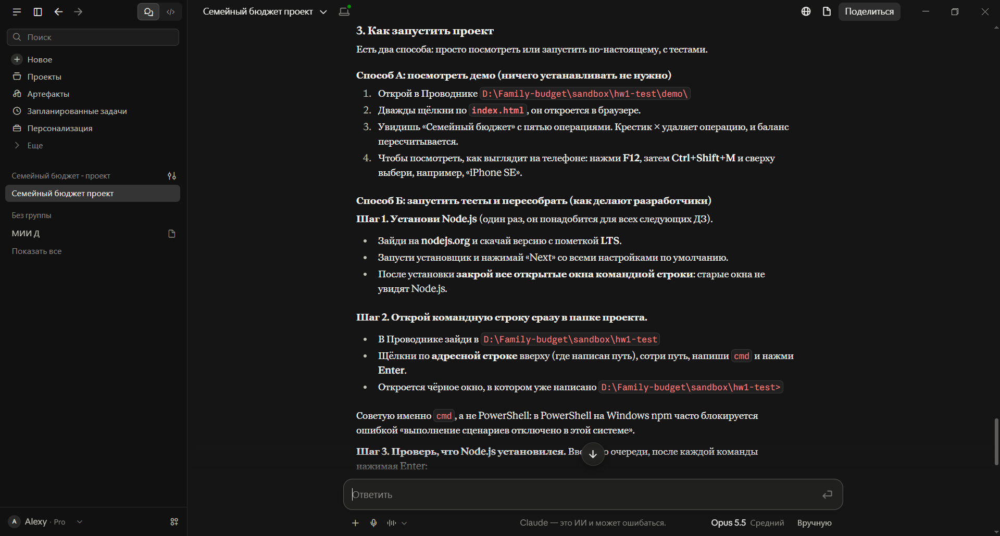
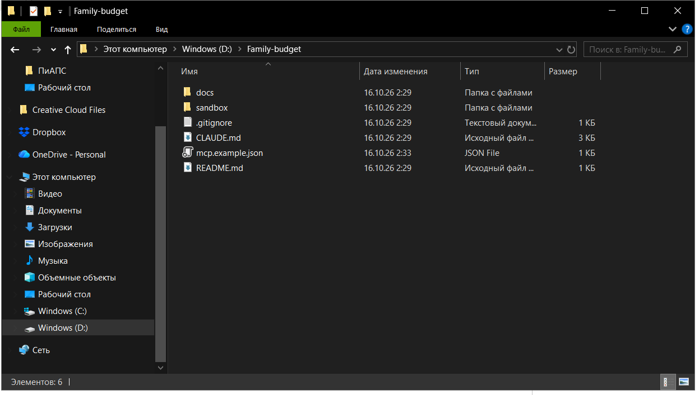
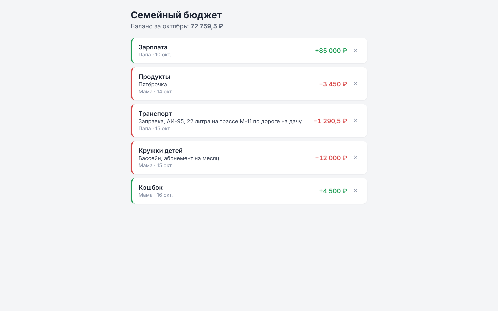
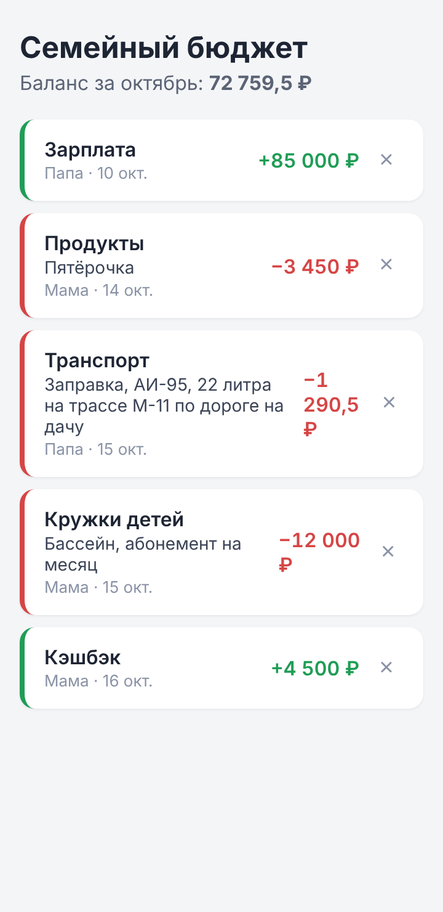
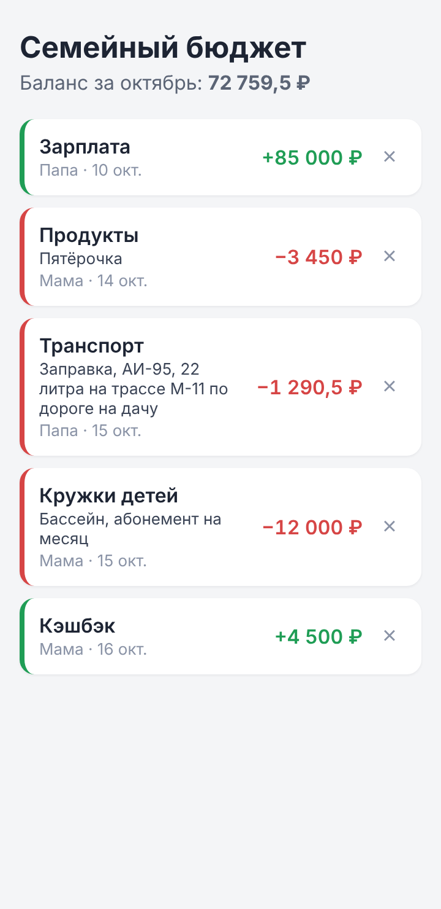
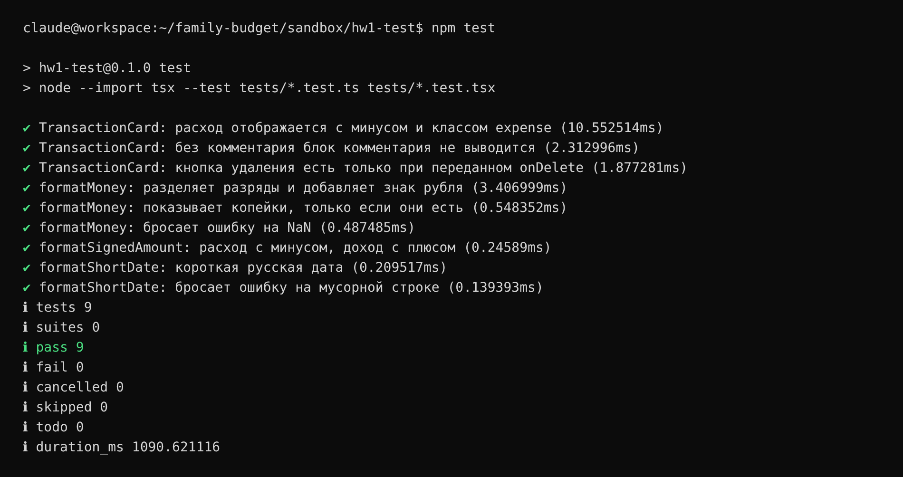

# ДЗ1. Сравнительный анализ и настройка AI-инструментов

**Проект:** «Семейный бюджет» — веб-приложение для совместного учёта доходов и расходов семьи
**Выбранный инструмент:** Claude Code (агент Anthropic: CLI, десктоп-приложение, расширения IDE)
**Дата:** 16.10.2026

---

## Итог в двух словах

Сравнил шесть инструментов: три облачных агента (Bolt.new, Lovable, Replit Agent) и три IDE/CLI-агента (Cursor, GitHub Copilot, Claude Code) по шести критериям с весами. Победил **Claude Code** со взвешенной оценкой 4,45 из 5. Близко к нему GitHub Copilot (4,35) и Cursor (4,30). Облачные агенты отстали (2,75–2,95): им не хватает доступа к локальному проекту и контроля над данными. Решающими стали полноценный агентный режим (агент сам читает проект, правит файлы, запускает тесты и команды) и то, что одним инструментом закрываются все этапы курса, от ТЗ до CI/CD. Инструмент настроен, на нём сделана тестовая задача: компонент `TransactionCard` и функции форматирования, 9 автотестов, проверка вёрстки на мобильной ширине.

---

## 1. Задача и требования (Шаг 1)

### 1.1. Описание задачи

Веб-приложение «Семейный бюджет» — аналог мобильных приложений учёта финансов, но для всей семьи сразу. Несколько членов семьи ведут общий бюджет, видят общие операции и лимиты.

Ключевые функции MVP:

1. Регистрация и вход, создание «семьи» и приглашение участников.
2. Учёт доходов и расходов: добавление, редактирование, удаление, фильтры.
3. Категории и месячные лимиты по категориям с предупреждением о превышении.
4. Дашборд: баланс за месяц, структура расходов, динамика по месяцам.

Целевой стек: React + TypeScript + Vite, Tailwind CSS, Supabase (PostgreSQL, Auth, RLS), деплой на Vercel, CI/CD на GitHub Actions.

### 1.2. Ключевые требования к AI-инструменту

| Требование | Описание | Важность |
|---|---|---|
| **Сложность** | Средняя: full-stack приложение (фронтенд, БД, авторизация, политики доступа RLS, графики, CI/CD). Проект развивается шесть этапов, кодовая база растёт, поэтому агент должен держать в голове весь проект, а не один файл. | Высокая |
| **Доступ к локальным файлам** | Нужен. Проект лежит локально (`D:\Family-budget`) и в GitHub. Агент должен читать и менять файлы, запускать `npm`, тесты, сборку и git. | Высокая |
| **Безопасность данных** | Приложение работает с финансовыми и персональными данными семьи. При разработке используются только мок-данные. Секреты (ключи Supabase, OAuth) нельзя отдавать в чужое облако и коммитить. Нужен контроль над тем, какие команды агент выполняет. | Высокая |
| **Бюджет** | Учебный проект, до ~2 000 ₽/мес (≈ $20). Желателен бесплатный тариф для старта. | Средняя |
| **Интеграция в процесс** | Работа под Windows, связка с VS Code, GitHub, браузером для проверки вёрстки. Поддержка MCP для подключения внешних сервисов (Supabase, браузер). | Средняя |
| **Скорость** | Важна, но качество и предсказуемость важнее: лучше медленнее, но с проверкой тестами. | Низкая |

### 1.3. Веса критериев

Из требований выведены веса для итоговой оценки:

| Критерий | Вес | Почему |
|---|---|---|
| Доступ к контексту проекта | 25% | Проект растёт шесть этапов, нужен контекст всего репозитория |
| Качество кода | 25% | Код сдаётся на проверку, нужны тесты и строгий TypeScript |
| Безопасность данных | 15% | Финансовые и персональные данные, секреты |
| Удобство интеграции | 15% | Windows + VS Code + GitHub + браузер |
| Стоимость | 10% | Есть ограничение бюджета |
| Скорость генерации | 10% | Вторична по отношению к качеству |

---

## 2. Сравнительный анализ инструментов (Шаг 2)

### 2.1. Cloud-агенты и IDE/CLI-агенты: в чём разница

- **Cloud-агенты** (Bolt.new, Lovable, Replit Agent) работают целиком в браузере: код, среда выполнения и хостинг находятся в облаке сервиса. Из текстового описания быстро получается работающий прототип с деплоем в один клик. Минусы: нет доступа к локальным файлам и инструментам разработчика, код и данные хранятся у провайдера, проектом сложно управлять вне их платформы.
- **IDE-агенты** (Cursor, GitHub Copilot) встроены в редактор кода. Они индексируют локальный проект, предлагают правки и в агентном режиме меняют несколько файлов. Разработчик остаётся в привычном редакторе и сам контролирует изменения.
- **CLI-агенты** (Claude Code, Gemini CLI, Aider, Codex) работают в терминале или отдельном приложении рядом с проектом. Агент сам читает файлы, выполняет команды (тесты, сборку, git) и проверяет результат. Это самый автономный вариант, но изменения нужно ревьюить.

### 2.2. Сравнительная таблица (оценки 1–5)

| Критерий (вес) | Bolt.new | Lovable | Replit Agent | Cursor | GitHub Copilot | **Claude Code** |
|---|:-:|:-:|:-:|:-:|:-:|:-:|
| Тип | Cloud | Cloud | Cloud | IDE | IDE | CLI |
| Доступ к контексту проекта (25%) | 2 | 2 | 3 | 5 | 4 | **5** |
| Скорость генерации кода (10%) | 5 | 5 | 4 | 4 | 5 | **3** |
| Качество кода (25%) | 3 | 3 | 3 | 4 | 4 | **5** |
| Стоимость использования (10%) | 4 | 3 | 3 | 3 | 5 | **3** |
| Безопасность данных (15%) | 2 | 2 | 2 | 4 | 4 | **4** |
| Удобство интеграции (15%) | 2 | 3 | 3 | 5 | 5 | **5** |
| **Взвешенная оценка** | **2,75** | **2,80** | **2,95** | **4,30** | **4,35** | **4,45** |
| Простая сумма (из 30) | 18 | 18 | 18 | 25 | 27 | 25 |

Взвешенная оценка = Σ (оценка × вес). Пример для Claude Code: 5·0,25 + 3·0,10 + 5·0,25 + 3·0,10 + 4·0,15 + 5·0,15 = 4,45.

Простая сумма без весов дала бы первое место Copilot (27): он дешевле и быстрее. Веса отражают требования из п. 1.2, где контекст проекта и качество кода важнее скорости и цены.

### 2.3. Стоимость (по данным на октябрь 2026)

| Инструмент | Бесплатно | Основной платный тариф |
|---|---|---|
| Bolt.new | 1 млн токенов/мес (300 тыс./день) | Pro — $25/мес, 10 млн токенов |
| Lovable | 5 кредитов в день (~30/мес) | Pro — от $25/мес за 100 кредитов |
| Replit | Starter, дневные лимиты агента | Core — ~$25/мес ($20 при оплате за год) + оплата сверх лимита по использованию |
| Cursor | Hobby: ограниченные автодополнения и запросы | Pro — $20/мес |
| GitHub Copilot | Free: ограниченные автодополнения и чат | Pro — $10/мес, Pro+ — $39/мес |
| Claude Code | — (нужна подписка) | Claude Pro — $20/мес, Max — от $100/мес |

Общее ограничение для всех шести сервисов: оплата зарубежной картой. Из России это требует обходных путей, и этот риск одинаков для всех вариантов.

### 2.4. Обоснование оценок

**Bolt.new (Cloud).** Самая быстрая генерация прототипа: веб-приложение с превью и хостингом за минуты. Но работает только внутри своей облачной среды (WebContainer), локальных файлов не видит, код и данные хранятся у сервиса. Дальнейшая работа вне Bolt возможна только через выгрузку кода. Токены быстро расходуются на больших проектах. Хорош для прототипа экрана, плох как основной инструмент на шесть этапов.

**Lovable (Cloud).** Генерирует React + Tailwind и из коробки интегрирован с Supabase, это плюс для нашего стека. Есть двусторонняя синхронизация с GitHub, поэтому интеграция оценена на 3. Ограничения те же, что у Bolt: контекст и выполнение только в облаке, кредиты расходуются на каждое сообщение, нет контроля над командами и тестами. Бесплатного тарифа (~30 кредитов в месяц) мало даже для одного этапа.

**Replit Agent (Cloud).** Полноценная облачная IDE с терминалом, поэтому контекст лучше, чем у Bolt и Lovable (3). Агент сам ставит зависимости и деплоит. Минусы: проект живёт на платформе Replit, а стоимость агента зависит от сложности задачи, поэтому её трудно предсказать.

**Cursor (IDE).** Форк VS Code с индексацией всего репозитория, агентным режимом, правилами проекта (`.cursorrules`) и MCP. Отличный контекст (5) и интеграция (5). Код хранится локально, есть Privacy Mode, но принудительно его включает только тариф Teams. Качество кода хорошее и зависит от выбранной модели. Минус: $20/мес, а лимиты Pro на агентные запросы ограничены кредитами.

**GitHub Copilot (IDE).** Лучшее соотношение цены и качества: $10/мес, есть бесплатный тариф, для студентов бывают бесплатные программы. Самые быстрые автодополнения в строке (5), работает в VS Code, JetBrains и на github.com. Есть агентный режим, но контекст всего проекта он использует слабее, чем Cursor и Claude Code (4). Отлично подходит как дополнение: автодополнение во время ручного редактирования.

**Claude Code (CLI / IDE / Desktop).** Агент читает весь репозиторий, сам выполняет команды (тесты, сборку, git), правит много файлов за раз и проверяет результат (контекст 5). Качество кода высокое, особенно на многошаговых задачах с тестами (5). Постоянные инструкции проекта задаются в `CLAUDE.md`, поддерживаются MCP, работает в терминале, VS Code, JetBrains, десктоп-приложении и браузере (интеграция 5). Скорость ниже (3): агент планирует, запускает проверки и итерирует, а не просто выдаёт код. По безопасности (4) код обрабатывается в облаке модели, как и у других инструментов, но выполнение команд и доступ к файлам идёт через систему разрешений. Подписка от $20/мес (3).

---

## 3. Выбор инструмента (Шаг 3)

### 3.1. Выбор: Claude Code

**Ключевые факторы:**

1. **Агентный режим полного цикла.** Агент сам пишет код, запускает тесты, видит ошибки и исправляет их. В тестовой задаче (раздел 5) он сам нашёл и исправил баг вёрстки по скриншоту мобильной версии. Для курса, где на каждом этапе требуются тесты и отладка, это главный фактор.
2. **Контекст всего проекта.** Проект растёт шесть этапов. `CLAUDE.md` хранит стек и правила между сессиями, агент читает нужные файлы сам.
3. **Один инструмент на все этапы.** ТЗ и User Stories (ДЗ3), код (ДЗ4), SQL-миграции и RLS (ДЗ5), GitHub Actions и аудит безопасности (ДЗ6) делаются одним агентом без переключения между сервисами.
4. **Контроль над данными и командами.** Проект хранится локально и в собственном GitHub-репозитории, а не на чужой платформе. Секреты остаются в `.env`.
5. **MCP.** Можно подключить браузер (проверка вёрстки и скриншоты) и в будущем Supabase.

### 3.2. Почему не подошли альтернативы

| Альтернатива | Почему не выбрана |
|---|---|
| Bolt.new, Lovable | Нет доступа к локальному проекту, код и выполнение в облаке провайдера, кредиты быстро заканчиваются на проекте из шести этапов. Можно использовать точечно для генерации прототипа экрана. |
| Replit Agent | Проект привязан к платформе, стоимость агента трудно предсказать. |
| GitHub Copilot | Сильный и дешёвый вариант, отстал от Claude Code на 0,1 балла. Уступает в автономности: самостоятельном выполнении многошаговых задач с запуском команд. Рекомендуется как дополнение для автодополнения в редакторе. |
| Cursor | Близок по возможностям. Не выбран, потому что Claude Code закрывает и задачи вне редактора: документацию, отчёты, работу с браузером и файлами. Два платных инструмента бюджет не позволяет. |
| Российские решения (GigaCode, YandexGPT) | В сравнение не входили по условиям задания. Это запасной вариант, если оплата зарубежных сервисов станет невозможна или потребуется хранить данные в РФ. |

---

## 4. Настройка рабочего окружения (Шаг 4)

### 4.1. Что установлено и настроено

| Шаг | Что сделано |
|---|---|
| 1. Установка | Десктоп-приложение Claude для Windows (включает Claude Code, отдельная установка CLI не нужна). Вход по подписке Claude. |
| 2. Папка проекта | Создана папка `D:\Family-budget` и подключена к сессии агента (кнопка **Add folder**). Агент получил доступ на чтение и запись только к этой папке. |
| 3. Среда выполнения | Агент выполняет команды (Node.js 22, тесты, сборку, браузер Chromium для скриншотов) в изолированном облачном рабочем пространстве и записывает результат в папку проекта на компьютере. |
| 4. Инструкции проекта | Создан `CLAUDE.md` в корне проекта: стек, структура, правила (строгий TypeScript без `any`, тесты к каждой функции, секреты только в `.env`, mobile-first вёрстка). |
| 5. MCP | Используются MCP-серверы десктоп-приложения: доступ к файлам компьютера и встроенный браузер. Для CLI-режима подготовлен `mcp.example.json` с Playwright MCP (проверка вёрстки в браузере); для подключения его нужно переименовать в `.mcp.json`. В ДЗ5 планируется подключить MCP Supabase. |
| 6. Тестовый проект | `sandbox/hw1-test` — функции форматирования и компонент `TransactionCard` с тестами (см. раздел 5). |
| 7. Служебные файлы | `.gitignore` (исключены `node_modules`, `.env`, сборка), `README.md` с таблицей домашних заданий. |

Альтернативная установка CLI-версии (для работы из терминала или VS Code):

```powershell
# Windows PowerShell
irm https://claude.ai/install.ps1 | iex
claude --version
cd D:\Family-budget
claude
```

### 4.2. Структура проекта после настройки

```text
D:\Family-budget\
├── CLAUDE.md               # постоянные инструкции для агента
├── README.md
├── .gitignore
├── mcp.example.json        # конфигурация MCP для CLI (переименовать в .mcp.json)
├── docs\
│   └── hw1\
│       ├── report.md       # этот отчёт
│       ├── report.docx
│       └── screenshots\
└── sandbox\
    └── hw1-test\           # тестовый проект
        ├── package.json
        ├── tsconfig.json
        ├── src\  (types.ts, format.ts, TransactionCard.tsx)
        ├── tests\ (format.test.ts, TransactionCard.test.tsx)
        └── demo\  (index.html, main.tsx)
```

### 4.3. Скриншоты настройки



*Рис. 1. Десктоп-приложение Claude: сессия агента с подключённой папкой `D:\Family-budget`.*



*Рис. 2. Папка проекта, созданная агентом.*

---

## 5. Практическое применение (Шаг 5)

### 5.1. Задача

Создать первый «кирпичик» будущего приложения: функции форматирования сумм и дат для русской локали и React-компонент карточки операции `TransactionCard`. Покрыть их тестами и проверить отображение на десктопе и телефоне.

### 5.2. Использованные промпты

**Промпт 1: генерация кода (структура Role-Task-Context-Format)**

```text
Ты — senior frontend-разработчик (React + TypeScript).
Задача: в проекте «Семейный бюджет» создай:
1) функции formatMoney(amount), formatSignedAmount(amount, type),
   formatShortDate(isoDate) для русской локали (12500 -> "12 500 ₽",
   расход "−1 200 ₽", доход "+50 000 ₽", "2026-10-16" -> "16 окт.");
   на некорректный ввод — RangeError;
2) компонент TransactionCard: категория, комментарий (если есть),
   автор и дата, сумма со знаком, цвет по типу операции,
   кнопка удаления только если передан onDelete.
Контекст: тип Transaction {id, type: 'income'|'expense', amount,
category, author, date, comment?}; строгий TypeScript без any.
Формат: отдельные файлы types.ts, format.ts, TransactionCard.tsx,
тесты на позитивные и негативные сценарии, демо-страница с мок-данными.
Запусти тесты и покажи результат.
```

**Промпт 2: проверка вёрстки**

```text
Открой демо-страницу на ширине 1280px и 360px (телефон), сделай
скриншоты, найди проблемы вёрстки и исправь их. Проверь, что нет
горизонтального скролла.
```

### 5.3. Ход работы по итерациям

| Итерация | Что сделал агент | Результат |
|---|---|---|
| 1 | Создал `types.ts`, `format.ts`, `TransactionCard.tsx`, 9 тестов (6 на функции, 3 на компонент) и демо-страницу. Сразу учёл, что `Intl.NumberFormat` для `ru-RU` ставит неразрывные пробелы (U+00A0, U+202F), и нормализовал их, чтобы строки предсказуемо сравнивались в тестах. | Все 9 тестов прошли с первого запуска (рис. 5). |
| 2 | Сделал скриншоты демо на 1280px и 360px. На десктопе всё корректно (рис. 3). На 360px нашёл баг: сумма «−1 290,5 ₽» разваливалась на три строки (рис. 4). | Баг найден |
| 2 (исправление) | Определил причину: в итерации 1 агент заменил неразрывные пробелы на обычные, и браузер начал переносить сумму по ним. Исправил CSS: `white-space: nowrap` для суммы, `flex-shrink: 0` для правой колонки, `min-width: 0` и `overflow-wrap: anywhere` для текстовой колонки, медиа-запрос для экранов ≤ 400px. Повторно снял скриншот и проверил отсутствие горизонтального скролла. | Сумма в одну строку, длинный комментарий переносится (рис. 6). |

**Всего:** 2 промпта, 2 итерации, ручных правок кода не было.

### 5.4. Возникшие сложности

1. **Неразрывные пробелы в `Intl`.** Классическая ловушка: `formatMoney(12500)` возвращает `"12 500 ₽"` с невидимыми U+00A0/U+202F, и тест со строкой из обычных пробелов падает. Агент учёл это заранее, но сама нормализация породила баг переноса на мобильном. Вывод: решение, правильное для тестов, нужно проверять и визуально. Хорошо, что агент проверил оба вида.
2. **Пакетный реестр npm недоступен из облачной среды агента.** Вместо Vite и Vitest тестовый проект собран на уже установленных React, tsx и esbuild с встроенным тест-раннером Node (`node:test`). На локальной машине проект ставится обычным `npm install`. В основном проекте (ДЗ4) будут Vite и Vitest.
3. **Ограничение безопасности при записи `.mcp.json`.** Удалённая запись конфигурации MCP на компьютер запрещена: это защита от подмены MCP-серверов. Файл сохранён как `mcp.example.json`, подключение — ручным переименованием. Это правильное поведение инструмента с точки зрения безопасности.
4. **Не нашёлся бинарник esbuild** под нужную платформу (пакет `@esbuild/linux-x64` не был связан с проектом). Агент сам нашёл причину по тексту ошибки и подключил пакет.

### 5.5. Результаты работы



*Рис. 3. Демо-страница с мок-данными, ширина 1280px.*

| До исправления | После исправления |
|:-:|:-:|
|  |  |
| *Рис. 4. 360px: сумма разбита на три строки* | *Рис. 6. 360px: сумма в одну строку* |



*Рис. 5. Прогон тестов: 9 из 9 пройдено.*

Фрагмент кода, созданного агентом (`src/format.ts`):

```ts
export function formatMoney(amount: number): string {
  if (!Number.isFinite(amount)) {
    throw new RangeError(`Некорректная сумма: ${amount}`);
  }
  return moneyFormatter.format(amount).replace(/[\u00A0\u202F]/g, ' ');
}

export function formatSignedAmount(amount: number, type: TransactionType): string {
  const sign = type === 'income' ? '+' : '−';
  return `${sign}${formatMoney(Math.abs(amount))}`;
}
```

Полный код — в папке `sandbox/hw1-test`.

---

## 6. Выводы и рекомендации

**Выводы:**

1. Для многоэтапного full-stack проекта главный критерий — доступ агента к контексту всего проекта и возможность самому проверять результат. По этим критериям IDE- и CLI-агенты заметно сильнее облачных (4,30–4,45 против 2,75–2,95).
2. Облачные агенты (Bolt, Lovable, Replit) хороши для быстрого прототипа и демонстрации идеи, но неудобны как основной инструмент: проект привязан к платформе, данные хранятся у провайдера, кредиты быстро заканчиваются.
3. Claude Code на тестовой задаче сделал код и тесты за одну итерацию и сам нашёл визуальный баг, который тесты не ловили. Значит, визуальная проверка (скриншоты на разных ширинах) должна быть обязательной частью процесса наравне с автотестами.
4. Постоянные инструкции в `CLAUDE.md` экономят время: стек и правила не нужно повторять в каждом промпте.

**Рекомендации для следующих этапов:**

1. Формулировать задачи агенту по структуре Role-Task-Context-Format с явным требованием «запусти тесты и покажи результат».
2. После каждой UI-задачи просить скриншоты на ширинах 360 / 768 / 1280px.
3. Расширять `CLAUDE.md` по мере роста проекта; в ДЗ2 он станет полноценным файлом правил.
4. Никогда не передавать агенту реальные финансовые данные и секреты: только мок-данные и `.env`, исключённый из git.
5. Для автодополнения при ручном редактировании можно дополнительно использовать GitHub Copilot (бесплатный тариф).

---

## Источники

- [Claude Code — документация (обзор, установка, MCP, CLAUDE.md)](https://code.claude.com/docs/en/overview)
- [Claude Code pricing 2026 — JetAdmin](https://www.jetadmin.io/blog/untitled-9/)
- [Bolt.new Pricing 2026 — JetAdmin](https://www.jetadmin.io/blog/bolt-new-pricing-plans-tokens-and-real-costs-in-2026/)
- [Lovable pricing 2026 — eesel.ai](https://eesel.ai/blog/lovable-pricing)
- [Replit Pricing 2026 — JetAdmin](https://www.jetadmin.io/blog/replit-pricing-in-2026-plans-credits-and-when-to-consider-jet-admin/)
- [Cursor Pricing 2026 — aicodereview.cc](https://aicodereview.cc/blog/cursor-pricing)
- [GitHub Copilot individual plans — GitHub Blog](https://github.blog/news-insights/company-news/github-copilot-individual-plans-introducing-flex-allotments-in-pro-and-pro-and-a-new-max-plan/)
