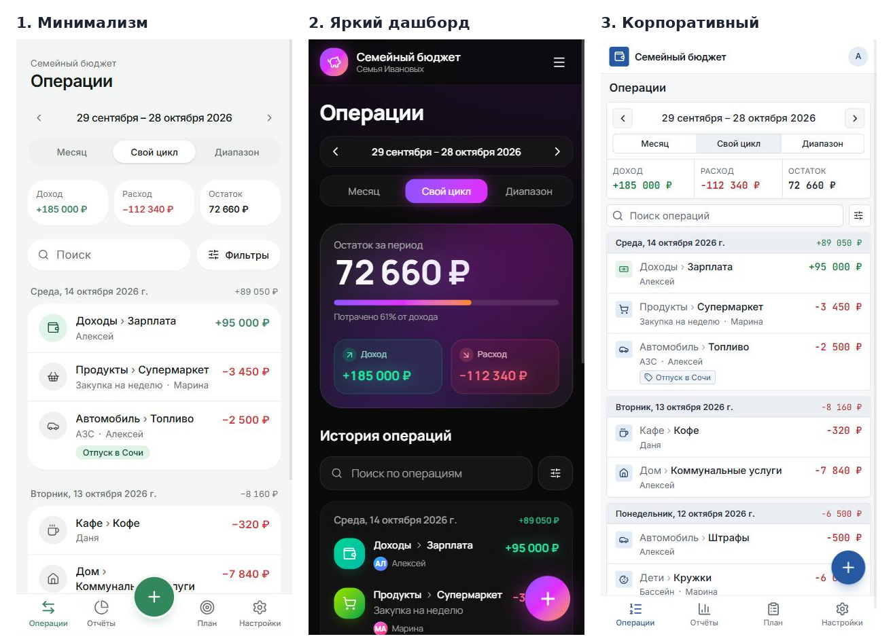
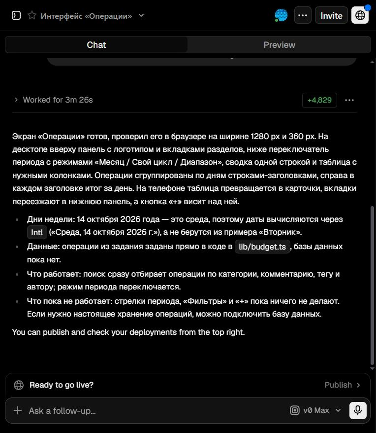
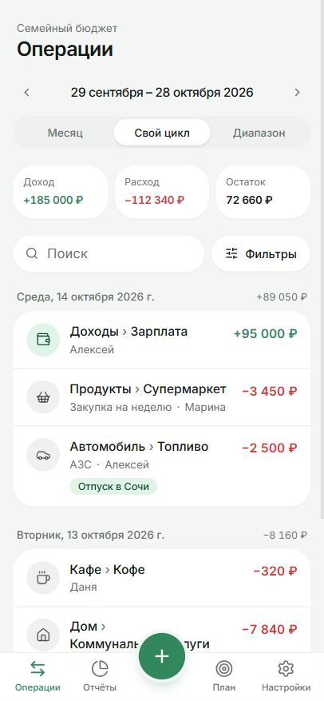
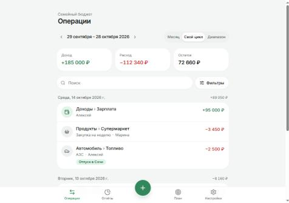
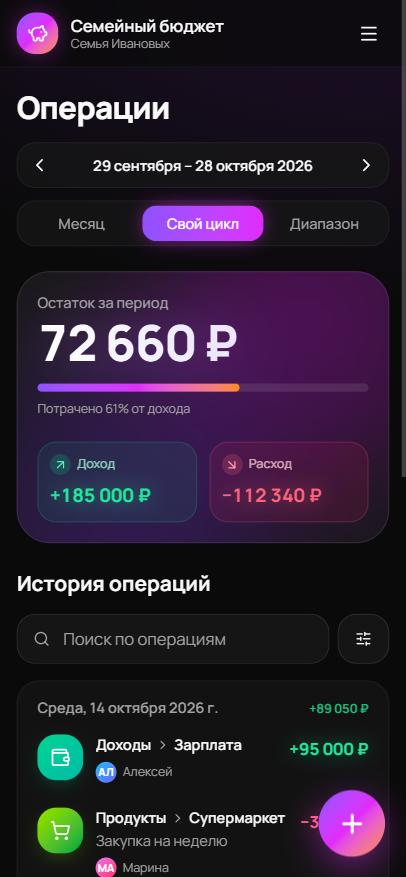
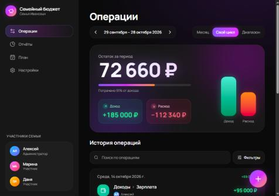
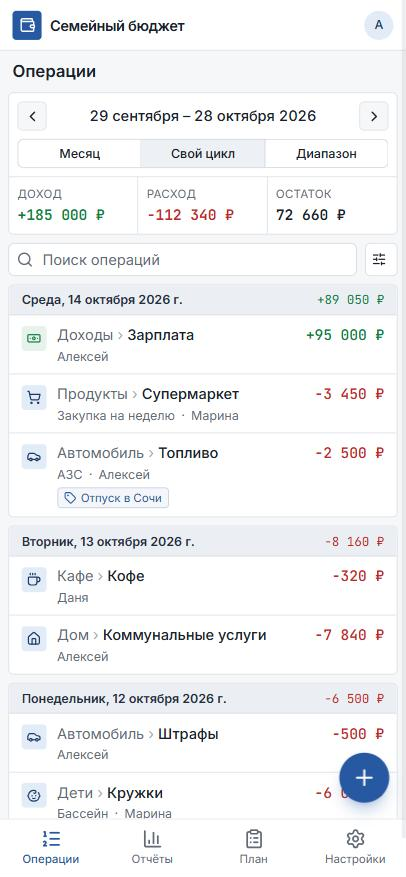
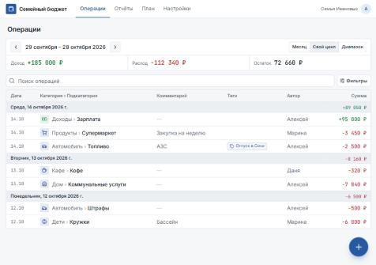

# UI-концепции экрана «Операции»

**Инструмент:** v0.dev (Vercel), text-to-UI генерация в React + Tailwind CSS + shadcn/ui.
**Промпты:** [prompts.md](prompts.md) — общий блок с одинаковыми данными и отдельный блок стиля
и компоновки для каждой концепции. **Чаты генерации:** [v0_links.md](v0_links.md).

Все три концепции генерировались для одного экрана — «Операции» — с одинаковыми данными,
чтобы сравнивать стиль и компоновку, а не содержимое. Каждая проверена на телефоне
(390 px) и на десктопе (1024 px).

*Три концепции на экране телефона (390 px).*

*Чат v0.dev после генерации концепции 3: v0 сам проверил вёрстку на 1280 и 360 px
и правильно вычислил день недели (14 октября 2026 — среда, а не вторник, как было в промпте).*

---

## Концепция 1 — «Минимализм»

| Телефон | Десктоп |
|:-:|:-:|
|  |  |

**Ключевые особенности:** светлая тема, белые карточки на светло-сером фоне, один зелёный акцент.
Компоновка мобильного приложения: нижняя панель с 4 разделами и большая кнопка «+» по центру.
Сводка — три карточки в ряд, операции — карточки по дням с итогом дня справа.

**Преимущества:**
- самая «дружелюбная» и спокойная, близка к мобильным приложениям вроде Money Flow;
- крупные элементы, удобно попадать пальцем; высокий контраст сумм;
- проще всего реализовать: стандартные компоненты shadcn/ui.

**Недостатки:**
- на десктопе это та же узкая колонка с нижней панелью — место не используется;
- на одном экране телефона помещается мало операций (около 5);
- длинное «Дом › Коммунальные услуги» переносится на две строки, и кнопка «+» перекрывает текст.

## Концепция 2 — «Яркий дашборд»

| Телефон | Десктоп |
|:-:|:-:|
|  |  |

**Ключевые особенности:** тёмная тема, фиолетово-розовые градиенты, крупный остаток
«72 660 ₽» с полосой «потрачено 61% от дохода» и столбиками доход/расход. На десктопе — левое
меню с аватарами участников семьи, на телефоне — выдвижное меню (☰).

**Преимущества:**
- самая эффектная и «современная»; остаток периода виден сразу и крупно;
- блок участников семьи на десктопе подчёркивает семейный характер приложения;
- полоса «потрачено от дохода» — полезная идея для сводки.

**Недостатки:**
- на телефоне сводка занимает весь первый экран, история начинается ниже сгиба;
- тёмные градиенты и мелкий серый текст хуже по контрасту (риск для WCAG AA);
- разделы спрятаны в меню ☰ — до «Отчётов» и «Плана» два нажатия;
- сложнее и дороже в реализации и поддержке (градиенты, свечение, тёмная тема — вне рамок v1.0);
- кнопка «+» перекрывает сумму операции.

## Концепция 3 — «Корпоративный»

| Телефон | Десктоп |
|:-:|:-:|
|  |  |

**Ключевые особенности:** строгая светлая тема, сине-серая палитра, плотная подача.
На десктопе — верхняя панель с вкладками разделов и **таблица** «Дата · Категория › Подкатегория ·
Комментарий · Теги · Автор · Сумма» со строками-заголовками дней и итогом дня.
На телефоне таблица превращается в карточки, вкладки уходят в нижнюю панель. Категория
показана серым, подкатегория — жирным; суммы — моноширинным шрифтом в столбик.

**Преимущества:**
- больше всего информации на экране: на телефоне 7 операций против 5;
- на десктопе полноценная таблица — привычно для тех, кто вёл бюджет в Google Таблицах (персона Алексей);
- подкатегория выделена жирным — это главный уровень детализации в нашем учёте;
- суммы ровно выровнены по правому краю, легко сравнивать;
- высокий контраст, простые компоненты — легко реализовать и проверить на доступность.

**Недостатки:**
- выглядит строже и «скучнее», меньше эмоций;
- кнопка «+» на телефоне перекрывает сумму последней видимой операции;
- моноширинный шрифт сумм выбивается из общего стиля.

---

## Сравнение

Оценки по шкале 1–5.

| Критерий | Почему важен | 1. Минимализм | 2. Яркий дашборд | 3. Корпоративный |
|---|---|:-:|:-:|:-:|
| Удобство на телефоне | основной сценарий — запись траты на ходу | 5 | 3 | 4 |
| Плотность информации | история — главный экран, операций много | 3 | 2 | 5 |
| Читаемость и контраст | деньги, доступность WCAG AA | 5 | 3 | 5 |
| Использование десктопа | анализ и настройка удобнее на компьютере | 2 | 4 | 5 |
| Простота реализации | срок курса, тесты, поддержка | 5 | 2 | 4 |
| Соответствие персонам | Алексей привык к таблицам, Марина — к телефону | 4 | 3 | 5 |
| **Сумма (из 30)** | | **24** | **17** | **28** |

## Выбор: концепция 3 «Корпоративный»

**Обоснование.** Главный экран приложения — история операций, и концепция 3 показывает
её лучше всех: больше операций на экране, явное выделение подкатегории, итог по каждому дню,
ровные столбцы сумм. Это единственная концепция, где десктоп и телефон продуманы одинаково
хорошо: таблица для анализа на компьютере, карточки и нижняя панель для быстрой записи
с телефона. Строгий стиль с высоким контрастом проще довести до WCAG AA и быстрее реализовать.

**Что берём из других концепций:**
- из концепции 1 — более мягкие скругления карточек и обычный (не моноширинный) шрифт сумм
  с выравниванием цифр `tabular-nums`, чтобы интерфейс не выглядел слишком «банковским»;
- из концепции 2 — полосу «потрачено от дохода» в сводке и список участников семьи
  в шапке десктопа (кто есть в семье).

**Что исправляем во всех концепциях** (будет требованием в ДЗ4): у списка операций снизу
должен быть отступ не меньше высоты кнопки «+», чтобы она не перекрывала последнюю строку;
длинные названия «Категория › Подкатегория» обрезаются многоточием, а не переносятся.
