# ДЗ4. Отчёт о разработке frontend-приложения с AI-агентом

**Проект:** «Семейный бюджет» — совместный учёт доходов и расходов семьи.
**AI-агент:** Claude (Anthropic), режим агента: сам создаёт файлы, запускает команды,
тесты и браузер, делает скриншоты и коммиты. Правила агента — [CLAUDE.md](../../CLAUDE.md) из ДЗ2.
**Репозиторий:** https://github.com/Akelov/family-budget · **запуск:** [README](../../README.md#запуск)

## Итог

| Критерий ДЗ | Результат |
|---|---|
| Работающее приложение | `npm install && npm run dev`; онлайн-версия публикуется GitHub Actions на GitHub Pages |
| ≥ 3 основные функции из ТЗ | 4 раздела: операции (FR-3), отчёты (FR-4), план-бюджеты (FR-7), настройки (FR-2, FR-5, FR-6, роли §3.2) |
| Состояния loading / error / success | на каждом экране + пустые состояния из ТЗ §6.2 |
| Адаптивность | 360 – 1440 px без горизонтальной прокрутки (автопроверка 6 ширин × 5 страниц) |
| Автотесты ≥ 3 | **87 тестов в 19 файлах**, все проходят; линтер и проверка типов — без ошибок |
| Документация | README, этот отчёт, [промпты](prompts.md), [41 скриншот](screenshots), JSDoc в `model/` |

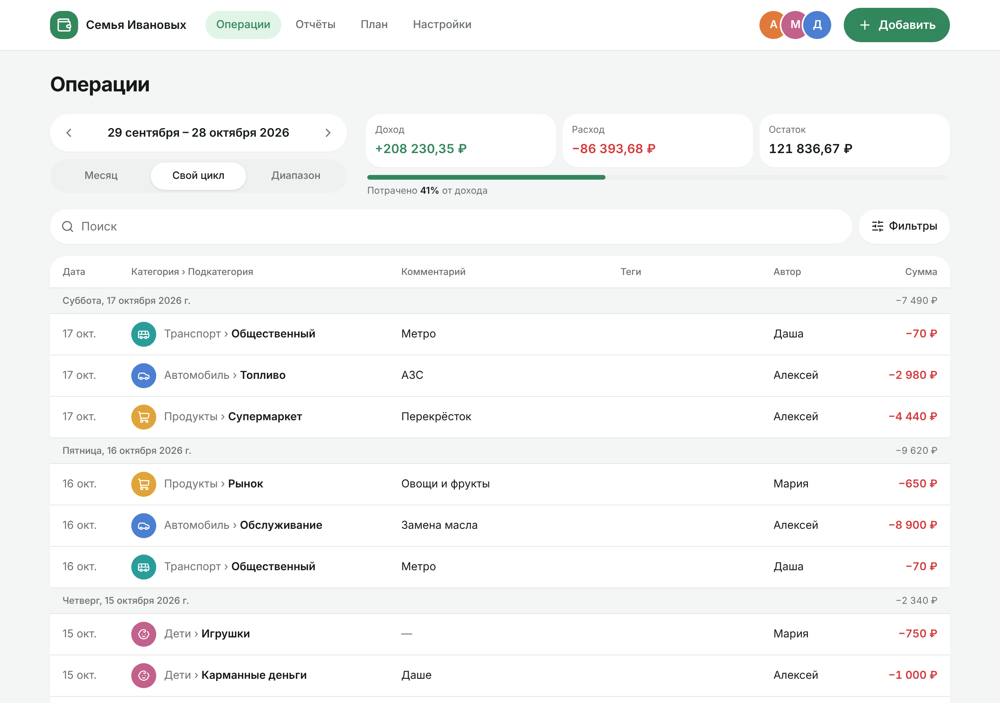 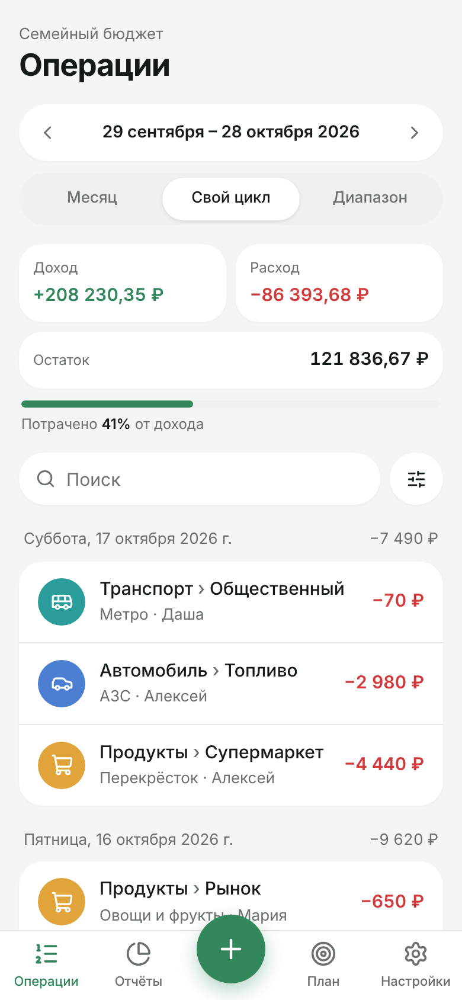

---

## Шаг 1. Техническое задание и стек

ТЗ взято из ДЗ3 ([technical_specification.md](../hw3/technical_specification.md)),
дизайн — итоговая UI-концепция 4 и макеты всех экранов
([ui_description.md](../hw3/ui_concepts/ui_description.md#макеты-всех-экранов)).

**Объём ДЗ4** (ТЗ §7): все экраны на мок-данных, логика периода и бюджетов в `model/`.
Вход, регистрация, приглашения и сервер — в ДЗ5 (Supabase).

| Функция | Требования ТЗ | Что реализовано |
|---|---|---|
| Операции | FR-3.1 – FR-3.14 | добавление, изменение, удаление с отменой; период, сводка, поиск, фильтры, история по дням, подгрузка по 50 |
| Отчёты | FR-4.1 – FR-4.6 | диаграмма и список с долями ровно 100 %, раскрытие до подкатегорий, переход в операции, теги |
| Отчётный период | FR-5.1 – FR-5.8 | месяц, цикл с дня N (с краевыми случаями коротких месяцев), диапазон, личный вид, период в адресе |
| Бюджеты | FR-7.1 – FR-7.7 | статус по копейкам, период семьи, категории целиком и подкатегории, создание и изменение |
| Настройки | FR-2, FR-6, §3.2, §4.8 | категории с архивом и удалением, теги (переименование, объединение), участники и роли, личный вид периода |

**Стек** (зафиксирован в CLAUDE.md, правило 5): React 19, TypeScript strict, Vite 7,
Tailwind CSS 4, React Router 7, Recharts 3, lucide-react, Vitest 3 + Testing Library, ESLint 9 + Prettier.
Почему так: Vite даёт мгновенный hot reload и простую сборку; Tailwind позволяет перенести
дизайн-токены v0 один в один (`@theme`) и верстать mobile-first; Recharts — готовая кольцевая
диаграмма; Vitest использует ту же конфигурацию, что Vite.

## Шаг 2. Инициализация проекта

Проект создан AI-агентом в корне репозитория (промпт — [prompts.md, №2](prompts.md#2-инициализация-проекта-шаблон-1)):

| Файл | Назначение |
|---|---|
| `package.json` | зависимости с точными версиями, скрипты `dev`, `build`, `test`, `lint`, `typecheck`, `format` |
| `vite.config.ts` | React + Tailwind, алиас `@/`, базовый путь из `VITE_BASE`, отдельный чанк React, настройки Vitest |
| `tsconfig.app.json` | `strict`, `noUncheckedIndexedAccess`, `noUnusedLocals` — строже шаблона Vite |
| `eslint.config.js` | typescript-eslint **strict**; правило 16 (запрет `any`, `@ts-ignore`) и 19 (запрет moment, lodash, axios) проверяются линтером, а не только «на словах» |
| `.prettierrc` | правило 13: 2 пробела, одинарные кавычки, ширина 100 |
| `.github/workflows/ci.yml` | линтер → типы → тесты → сборка → публикация на GitHub Pages |
| `vercel.json`, `.env.example`, `.nvmrc` | готовность к Vercel и ДЗ5, версия Node.js |

**Применение правил ДЗ2.** `CLAUDE.md` агент читает в начале каждой сессии. В коде это видно:
деньги только в копейках (`parseAmount` разбирает строку без `parseFloat`), даты — строками
(`parseIsoDate` без `new Date(iso)`), JSDoc на русском у функций `model/`, один компонент — один файл,
`export default` только у страниц.

**Окружение разработки.** `npm run dev` — сервер с hot reload на `localhost:5173`.
`npm run preview` — собранная версия для скриншотов и проверки.

> Особенность среды агента: облачный контейнер выходит в интернет через прокси, и npm
> поначалу не видел реестр (`ENOTFOUND registry.npmjs.org`). Агент прочитал документацию
> прокси, нашёл, что переменная `npm_config_noproxy` направляла запросы к реестру мимо прокси,
> и запустил установку с исправленной переменной. На компьютере пользователя этой проблемы нет.

## Шаг 3. Базовая структура

```text
src/
  app/          main.tsx, App.tsx (провайдеры), router.tsx (ленивые страницы), layout/ (TopBar, TabBar)
  pages/        OperationsPage, ReportsPage, PlanPage, SettingsPage, NotFoundPage
  features/
    transactions/ api · model (filter, summary, group, validation, params, saveError) · hooks · components
    reports/      api · model (aggregate, percent) · hooks · components (DonutChart, ReportList)
    budgets/      api · model (budget) · components (BudgetCard, BudgetForm, BudgetItemsTree)
    period/       model (period) · hooks (usePeriod) · components (PeriodSwitcher, RangeDialog)
    categories/, tags/, household/, settings/
  shared/
    api/        mockDb (мок-сервер), seed (демо-данные), useQuery, errors
    lib/        money, dates, lookups, periodLink, logger, text, cn, id
    ui/         Button, Modal, SegmentedControl, Field, TextInput, Badge, Chip, ProgressBar,
                CategoryIcon, Avatar, Skeleton, LoadingState, ErrorState, EmptyState, ErrorBoundary, toast/
  test/         setup, fixtures, renderApp
```

**Ключевое архитектурное решение — мок-сервер с интерфейсом настоящего.** Функции
`features/*/api` повторяют RPC из ТЗ §3.3: `fetchTransactionsPage` = `list_transactions`,
`fetchSummary` = `period_summary`, `updateTransaction(id, expectedUpdatedAt, …)` = `update_transaction`
с кодами `forbidden` / `conflict` / `not_found`. Мок-сервер проверяет права и данные сам (как
ограничения БД), имитирует задержку 250–500 мс и умеет «падать» с ошибкой сети или 500.
В ДЗ5 заменится только реализация этих модулей — компоненты и хуки не изменятся.

**Роутинг:** `/` Операции, `/reports`, `/plan`, `/settings/:section`, `*` — «Страница не найдена».
Страницы загружаются лениво; период, поиск и фильтры живут в параметрах адреса (FR-3.14),
поэтому работают ссылки из отчётов и бюджетов и кнопка «Назад».

## Шаг 4. Компоненты интерфейса

| Экран | Компоненты | Состояния |
|---|---|---|
| Каркас | `TopBar` (десктоп), `TabBar` с «+» (телефон), `ErrorBoundary` на раздел | — |
| Операции | `PeriodSwitcher`, `SummaryCards`, `OperationsToolbar` (`SearchField`, `FiltersDialog`), `TransactionList` / `TransactionTable`, `LoadMore` | скелетон, ошибка с «Повторить», баннер «данные могут быть неактуальны», «В этом периоде пока нет операций», «Ничего не найдено» |
| Форма операции | `TransactionForm`, `AmountInput`, `CategoryPicker`, `SubcategoryPicker`, `TagsInput`, `DateCommentFields` | ошибки полей (ERR-1), сохранение, сеть с «Повторить» (ERR-2), конфликт (ERR-8), только просмотр чужой операции |
| Отчёты | `DonutChart` (Recharts), `ReportList`, `ReportView` | скелетон, ошибка, «За этот период расходов нет» |
| План | `BudgetCard`, `BudgetForm`, `BudgetItemsTree` | скелетон, ошибка, «Бюджетов пока нет» |
| Настройки | `ProfileSection`, `FamilySection`, `CategoriesSection` + `CategoryEditor`, `TagsSection`, `MembersSection`, `DeveloperSection` | права ролей: недоступное скрыто |

**Как работали с агентом.** Каждый экран — промпт по шаблону ДЗ2 №1 с требованиями ТЗ и макетом,
затем итерации по скриншотам (шаг 5). Данные — демо-семья с операциями за 4 месяца,
сгенерированными относительно сегодняшней даты (отпуск, ремонт кухни, день рождения — чтобы
отчёты и теги выглядели живыми). Блок «Для разработчика» в настройках позволяет войти от имени
другого участника, включить имитацию ошибок и сбросить данные — так проверяются права и состояния ошибок.

| | |
|:-:|:-:|
| 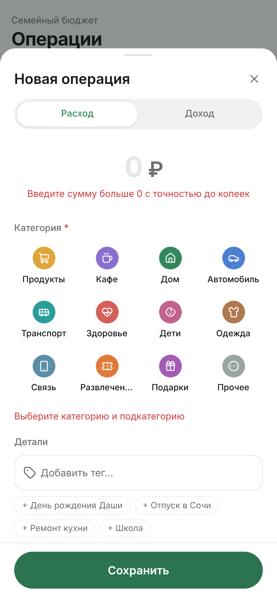 | 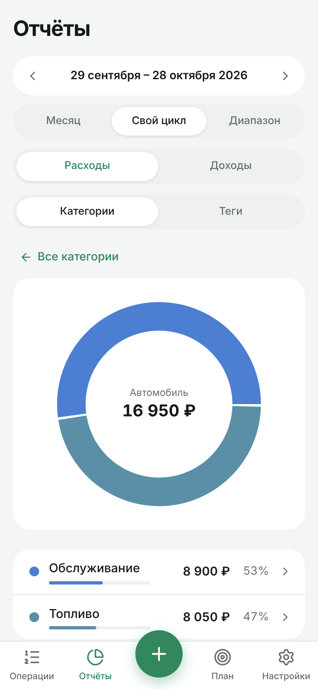 |
| Форма: ошибки после «Сохранить», фокус на сумме | Отчёт: подкатегории «Автомобиля» |
| 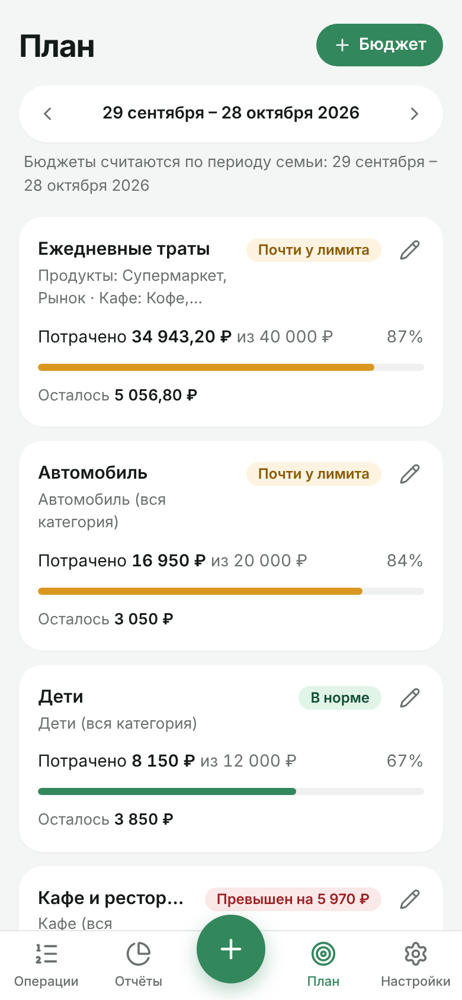 | 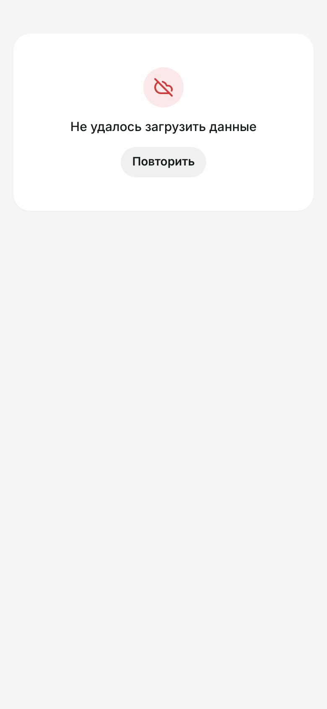 |
| План: статусы бюджетов | Ошибка 500 после двух автоповторов (ERR-4) |

## Шаг 5. Тестирование и отладка

### Автотесты

`npm test` → **19 файлов, 87 тестов, все проходят** (≈ 25 с). Тесты лежат рядом с кодом (правило 24).

| Уровень | Файлы | Тестов | Что проверяют |
|---|---|:-:|---|
| Бизнес-логика `model/` | period, filter, summary, validation, params, saveError, aggregate, percent, budget, rules, permissions | 59 | периоды из приложения C ТЗ (короткие месяцы, високосный год, переход года), фильтры «И»/«ИЛИ», поиск, проценты = 100, статусы бюджета на границах 80 % и 100 %, права ролей |
| Утилиты `shared/lib` | money, dates | 10 | разбор суммы без float, формат «−2 500 ₽», копейки только при наличии, даты без часовых поясов |
| API мок-сервера | transactionsApi | 6 | повтор с тем же id не создаёт дубликат, конфликт / нет прав / не найдена, ошибка сети не сохраняет, восстановление на прежнее место |
| Компоненты и экраны | OperationsPage, TransactionForm, BudgetCard, ReportsPage, SettingsPage | 12 | история и сводка, поиск, пустой период, ошибка 500 → «Повторить», ошибки формы и фокус, сохранение с новым тегом, удаление и «Отменить», статусы бюджетов, раскрытие отчёта и переход в операции, права участника |

Каждая функция `model/` имеет позитивный сценарий, краевой случай и ошибку (`RangeError` на
некорректных датах и суммах). Тесты экранов рендерят приложение целиком в памяти (`createMemoryRouter`)
с фиксированной датой «сегодня» = 17.10.2026: подменяются только часы, а не таймеры, чтобы работали
задержка поиска и мок-сервера.

### Отладка с помощью мультимодальной модели

Агент собрал приложение, снял скриншоты Playwright-скриптом ([scripts/screenshots.mjs](../../scripts/screenshots.mjs))
и **сам анализировал изображения**, как пользователь смотрит на экран. Скрипт дополнительно измеряет
горизонтальную прокрутку и собирает ошибки консоли. Найдено и исправлено:

| № | Что увидели на скриншоте | Причина | Исправление |
|:-:|---|---|---|
| 1 | 390 px: суммы в сводке обрезаны «+208 230…», «−86 393,…» | три карточки в ряд по ~90 px не вмещают сумму с копейками | на телефоне Доход и Расход в ряд, Остаток — на всю ширину; с 640 px — три в ряд |
| 2 | Десктоп: строка поиска «прилипла» к таблице | общий отступ `gap-1` рассчитан на телефон | `lg:gap-4` |
| 3 | Отчёт по подкатегориям: кольцо одного цвета, сегменты сливаются | подкатегории наследовали цвет категории | цвета по палитре со сдвигом, самая крупная — цвет категории; тест «у подкатегорий разные цвета» |
| 4 | Форма: знак ₽ далеко от суммы | поле фиксированной ширины 280 px с текстом по центру | ширина по содержимому (`ch`) и выравнивание вправо |
| 5 | 360 px: «29 сентября – 28 октября 20…» | 15 px не помещается между стрелками | 14 px до 400 px ширины |
| 6 | 360 px, «План»: прокрутка вбок на 23 px (нашла автопроверка) | элемент сетки по умолчанию `min-width: auto` растягивается по неразрывному названию бюджета | `min-w-0` у карточки; поиск виновника — скрипт, выводящий элементы с `right > innerWidth` |

| До | После |
|:-:|:-:|
| 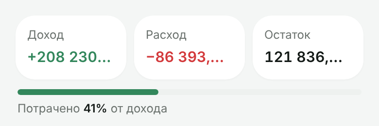 | 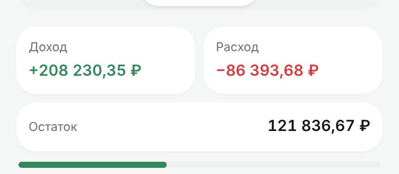 |
| 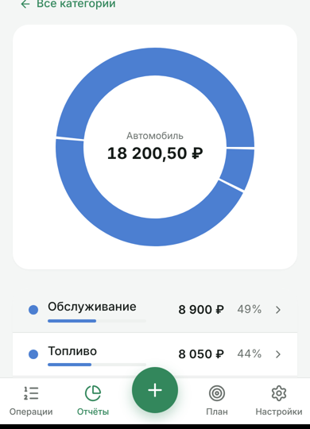 | 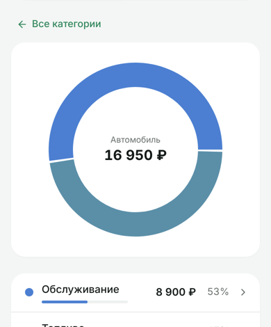 |
|  |  |
| 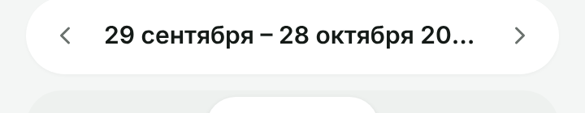 | 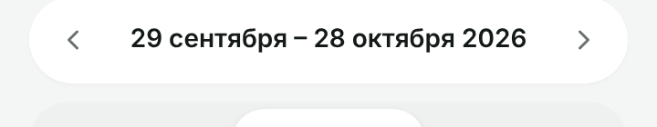 |

### Интерпретация ошибок консоли и инструментов

| Сообщение | Интерпретация агента | Действие |
|---|---|---|
| `Failed to load resource: net::ERR_TUNNEL_CONNECTION_FAILED` (консоль браузера) | запрос к fonts.googleapis.com блокирует сеть среды агента; у пользователя шрифт грузится, а в среде агента подставляется установленный Inter | не баг приложения; скрипт скриншотов игнорирует именно эту ошибку, остальные считает провалом |
| ESLint `no-irregular-whitespace` в `money.ts` | в регулярном выражении оказались «невидимые» неразрывные пробелы вместо ` ` | заменены на escape-последовательности. Первая автоматическая правка заменила их обычными пробелами и сломала разбор суммы — агент заметил это, перечитав строку, и вернул ` `; тесты `parseAmount` это бы тоже поймали |
| TypeScript `TS2300: Duplicate identifier 'LucideIcon'` | после выноса констант палитры импорт продублировался | убран дубль |
| ESLint `react-refresh/only-export-components` | в файле компонента экспортировались константы — ломает hot reload | палитра вынесена в `categoryPalette.ts` |
| Testing Library: `Found multiple elements with the role "button" and name "Добавить операцию"` | не баг: в пустом состоянии две такие кнопки — в пустом блоке и «+» в панели | тест уточнён: ожидаются ровно 2 |
| Тест один раз упал по тайм-ауту 5 с при параллельной сборке | интеграционные тесты рендерят всё приложение; под нагрузкой не хватает времени | `testTimeout: 10 000`; в 9 повторных прогонах падений нет |
| CI на GitHub: `Found multiple elements with the text: /Перекрёсток/` в тесте поиска | на медленной машине CI поиск (300 мс + задержка сервера) не успевал за 1 с ожидания `waitFor`; `queryByText` при нескольких совпадениях бросает ошибку, а не возвращает «есть» | ожидание `queryAllByText(…)` с длиной 0 и тайм-аутом 5 с; тест не ослаблен — проверяет то же самое. Это тот же нестабильный тест, что однажды упал локально |
| CI: `Failed to create deployment (status: 404) … Ensure GitHub Pages has been enabled` | проверки прошли, но в репозитории не включён GitHub Pages | Pages включает владелец репозитория (Settings › Pages › Source: GitHub Actions) |

## Шаг 6. Адаптивная вёрстка

Mobile-first (правило 15): базовые классы Tailwind — для 360 px, затем `sm:` (640), `md:` (768), `lg:` (1024).

| Ширина | Раскладка |
|---|---|
| 360 – 639 | нижняя панель с «+», карточки операций по дням, сводка 2 + 1, окна — нижний лист |
| 640 – 1023 | контент 640 px по центру, сводка в 3 колонки, окна по центру, бюджеты в 2 колонки с 768 |
| ≥ 1024 | верхняя панель с вкладками и «+ Добавить», таблица операций, отчёт «диаграмма + список», настройки в две колонки, бюджеты в 3 колонки |

Проверка: скрипт открывает 5 страниц на **360, 390, 768, 1024, 1280 и 1440 px** (эмуляция
устройства в Chromium через Playwright, плотность пикселей 2), измеряет `scrollWidth − innerWidth`
и собирает ошибки консоли. Итог последнего прогона: «ошибок в консоли нет, горизонтальной прокрутки нет».
Также учтены `safe-area-inset-bottom` для телефонов с «чёлкой», `prefers-reduced-motion`,
фокус-обводка для клавиатуры, удержание фокуса в окнах и закрытие по Esc.

| 360 | 768 | 1024 | 1440 |
|:-:|:-:|:-:|:-:|
| 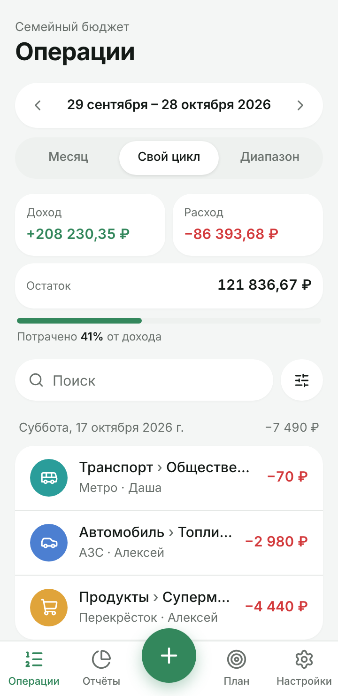 | 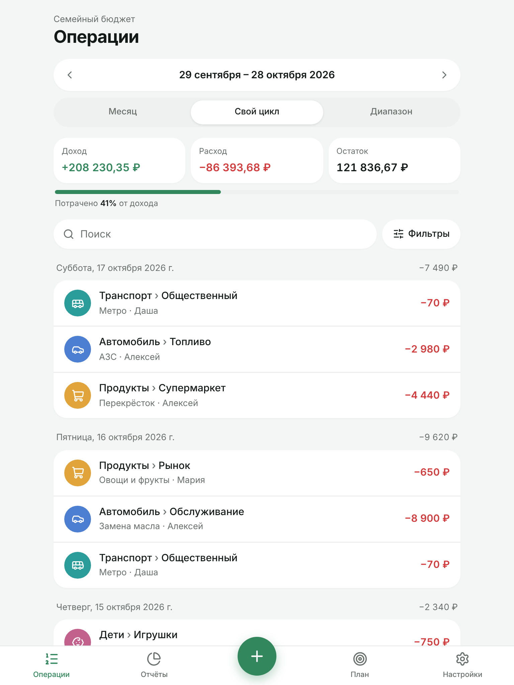 | 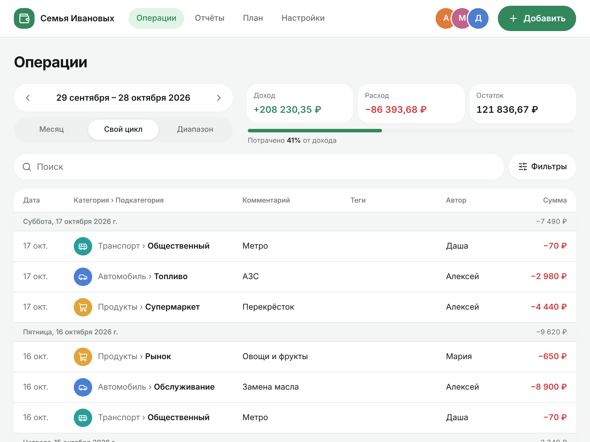 | 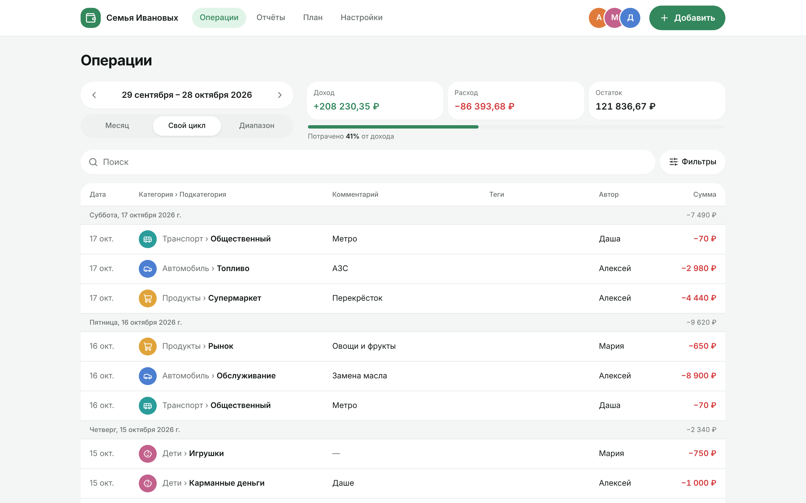 |

## Шаг 7. Рефакторинг и оптимизация

| Что было | Что стало | Чем проверено |
|---|---|---|
| `groupByDay` пересоздавал группу при каждой операции (O(n²) внутри дня) | один проход через `Map` | замер на 5 000 операций: **6,4 → 3,3 мс**; тесты группировки |
| `ReportsPage` — около 100 строк: параметры адреса, загрузка и разметка вместе | хуки `useReportParams` и `useReport`, страница — только разметка | тесты отчётов без изменений |
| `TransactionForm` — классификация ошибок сохранения внутри компонента | чистая функция `saveErrorKind` в `model/` с тестом; поля даты и комментария — компонент `DateCommentFields` | тесты формы без изменений |
| `useTransactionQuery`: `eslint-disable` ради стабильных фильтров | стабильный строковый ключ из параметров фильтров, подавление удалено | линтер без исключений |
| Один большой JS-файл | ленивые страницы; Recharts только в чанке «Отчётов»; React и роутер — отдельный чанк | `vite build`: код приложения **75 КБ** (26 КБ gzip), React 315 КБ, «Отчёты» 297 КБ — грузятся при открытии раздела |

Читаемость: все функции бизнес-логики — с JSDoc и краевыми случаями (правило 12), комментарии
объясняют «почему» (например, почему статус бюджета считается по копейкам, а не по проценту).

## Шаг 8. Оформление

- [README](../../README.md): описание, возможности, стек, запуск, команды, структура, деплой.
- [package.json](../../package.json) с зависимостями, 87 тестов в репозитории.
- Этот отчёт, [промпты](prompts.md), [скриншоты](screenshots), [до/после отладки](debug).

---

## Техники работы с AI и что оказалось эффективнее

| Техника | Как применялась | Оценка |
|---|---|---|
| **Правила проекта (CLAUDE.md)** | стек, архитектура, запреты, формат ответа — один раз, а не в каждом промпте | самая полезная: код с первого раза в копейках, без `any`, с тестами рядом |
| **Промпт-шаблоны RTCF из ДЗ2** | каждый шаг — по шаблону с ссылками на пункты ТЗ (FR-…) | ссылки на ID требований экономят текст и не дают агенту «додумывать» |
| **Декомпозиция** | ДЗ разбито на подзадачи; после каждой — сборка и тесты | ошибки локализуются сразу, а не в конце |
| **Тест-кейсы из ТЗ** | приложение C ТЗ (циклы, статусы бюджета) напрямую стало тестами | граничные случаи (31-е число, 80 000,01 ₽) проверены автоматически |
| **Отладка по скриншотам** | агент снимает экран Playwright и анализирует изображение | нашла 5 из 6 визуальных багов, которых не видно в тестах |
| **Автопроверка вёрстки скриптом** | `scrollWidth − innerWidth` на 6 ширинах + ошибки консоли | нашла баг, пропущенный «глазами» (прокрутка 23 px на 360 px) |
| **Интерпретация ошибок** | сообщения линтера, TypeScript, тестов, CI — агент объясняет причину перед правкой | отделяет баги приложения от особенностей среды (шрифт, прокси, Pages) |

## Проблемы и решения

| Проблема | Решение |
|---|---|
| npm в среде агента не видел реестр | исправлена переменная `npm_config_noproxy` (см. шаг 2) |
| Нужно проверять права ролей без входа (Auth — в ДЗ5) | «Настройки › Для разработчика › Войти как» |
| Нужно показывать состояния ошибок без настоящего сервера | имитация ошибки сети и 500 в мок-сервере, автоповтор чтения 2 раза (1 и 3 с) |
| SPA на GitHub Pages: прямая ссылка `/family-budget/reports` даёт 404 | `404.html` = копия `index.html`, `basename` роутера из `BASE_URL`; проверено локально |
| Автоматическая правка сломала регулярное выражение | правки агента проверяются чтением результата и тестами, а не только линтером |
| Агенту нельзя включить GitHub Pages через API (ограничение среды) | включает владелец репозитория в настройках; CI-проверки уже зелёные |

## Выводы и рекомендации

1. **ТЗ с ID требований и примерами — лучший «промпт».** Чем точнее ДЗ3, тем меньше итераций в ДЗ4:
   приложение C ТЗ превратилось в тесты почти без изменений.
2. **Мок-сервер с интерфейсом будущего API** позволил сделать все состояния (загрузка, ошибки, конфликт,
   права) уже сейчас, а в ДЗ5 заменить только слой `api/`.
3. **Тесты не заменяют взгляд на экран.** 87 тестов не поймали ни одного из 6 визуальных багов —
   их нашли скриншоты и автопроверка ширины. Рекомендация: держать скрипт скриншотов в проекте и
   прогонять перед каждым коммитом с вёрсткой.
4. **Проверять правки агента.** Одна автоматическая правка сломала код, хотя линтер стал «зелёным»:
   смысл изменения важнее отсутствия предупреждений.
5. **Что дальше (ДЗ5):** схема БД и RLS по ТЗ §3, RPC вместо мок-сервера, вход через Supabase Auth,
   приглашения; блок «Для разработчика» уйдёт.
