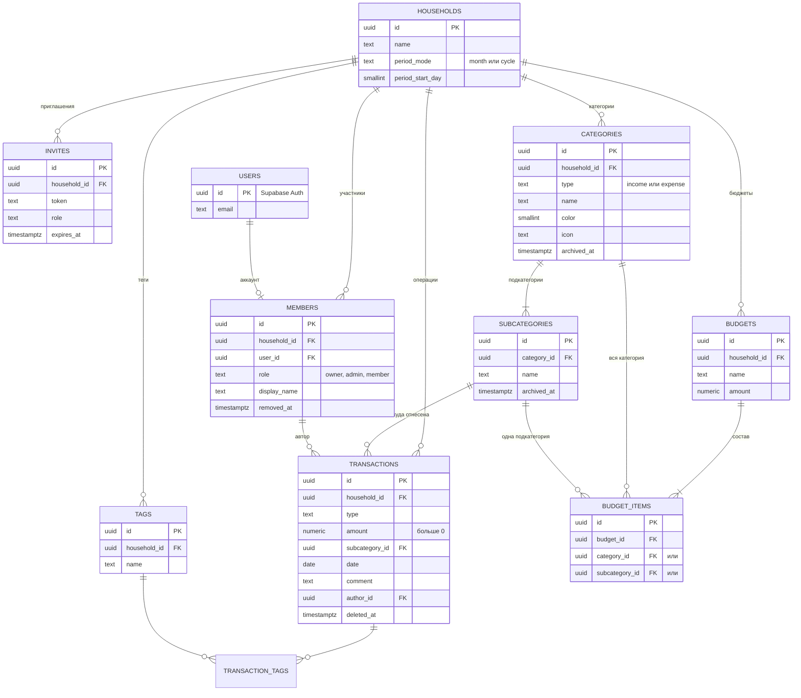

# Шаг 1. Проектирование базы данных

Схема построена по ТЗ из ДЗ3 (§3.1 «Модель данных»). Готовый SQL —
[supabase/migrations/20261017120000_schema.sql](../../supabase/migrations/20261017120000_schema.sql).

## Схема связей

Ещё одна таблица, `client_errors`, — журнал ошибок интерфейса, она ни с чем не связана, кроме семьи.

## Таблицы простыми словами

| Таблица | Что хранит | Главное правило |
|---|---|---|
| `households` | семья: название и как считается период (месяц или цикл с N-го числа) | удаление семьи удаляет все её данные |
| `members` | кто входит в семью и с какой ролью | один владелец на семью; пользователь — максимум в одной семье; при исключении строка остаётся с пометкой `removed_at`, чтобы у старых операций было имя автора |
| `invites` | одноразовые ссылки-приглашения | срок 7 дней, токен — случайная строка |
| `categories` | категории доходов и расходов | название не повторяется в семье (без учёта регистра) |
| `subcategories` | подкатегории внутри категории | нельзя удалить, если на неё есть операции |
| `transactions` | операции: сумма, дата, подкатегория, автор, комментарий | сумма > 0; тип совпадает с типом категории; дата не в будущем; удаление «мягкое» (`deleted_at`) — для кнопки «Отменить» |
| `tags`, `transaction_tags` | теги и какие теги у какой операции (многие ко многим) | не больше 10 тегов на операцию |
| `budgets`, `budget_items` | бюджет и его состав | элемент — либо категория целиком, либо одна подкатегория; только расходы |
| `client_errors` | ошибки, которые произошли у пользователей в интерфейсе | клиент может только добавлять |

## Почему так устроено

- **`uuid` вместо номеров 1, 2, 3.** Номера можно перебирать и угадывать; uuid — нет. А id операции
  создаёт сам браузер, чтобы повторное нажатие «Сохранить» при плохой сети не создало дубликат.
- **Деньги — `numeric(12,2)`**, а не дробные числа: в базе 0,10 + 0,20 ровно 0,30.
- **`household_id` почти в каждой таблице.** По нему правила доступа (шаг 5) проверяют,
  что человек видит только свою семью.
- **Правила проверяет сама база**, а не только сайт: даже если кто-то отправит запрос мимо
  интерфейса, база не примет сумму 0 или операцию на чужую подкатегорию.
- **Row Level Security включён сразу.** Пока правил доступа нет, через API таблицы закрыты
  для всех — безопасное состояние по умолчанию. Правила добавим на шаге 5.

## Проверка

Миграция применена к локальному PostgreSQL 16 (с заглушкой окружения Supabase —
[supabase/local/supabase_stub.sql](../../supabase/local/supabase_stub.sql)). Нормальная операция
создаётся, а неправильные данные база отклоняет:

| Попытка | Ответ базы |
|---|---|
| Доход в расходную подкатегорию | `Тип операции не совпадает с типом категории` |
| Сумма 0 | нарушено ограничение `transactions_amount_check` |
| Дата через 5 дней | `Дата не может быть в будущем` |
| Категория «  продукты » при существующей «Продукты» | нарушена уникальность `categories_unique_name` |
| Второй владелец в семье | нарушена уникальность `members_one_owner_per_household` |
| Удалить подкатегорию, на которую есть операции | нарушен внешний ключ `transactions_subcategory_id_fkey` |
