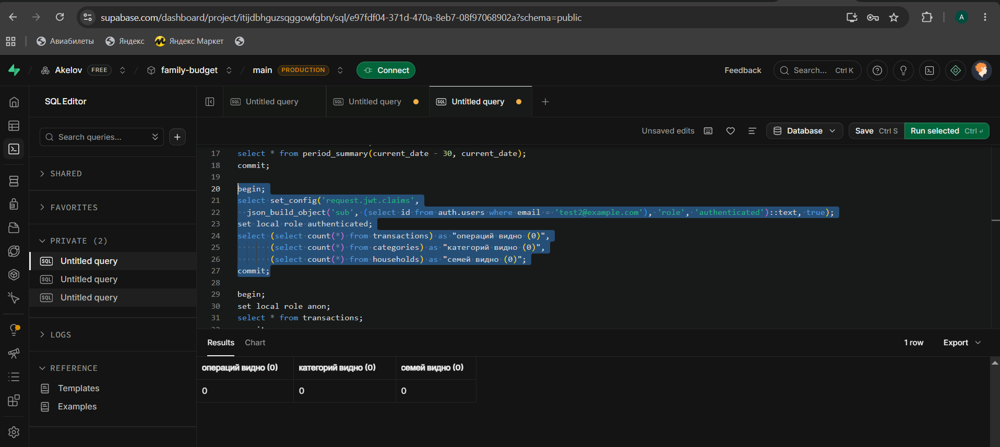
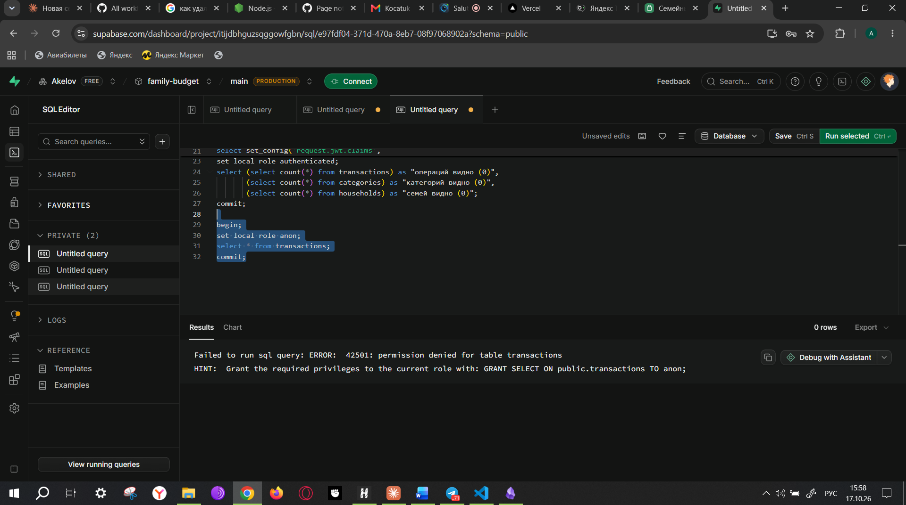

# Шаг 5. Безопасность

## Row Level Security — правила доступа в самой базе

Файл: [supabase/migrations/20261017140000_rls_policies.sql](../../supabase/migrations/20261017140000_rls_policies.sql).
Реализует матрицу прав из ТЗ §3.2.

| Таблица | Читать | Изменять |
|---|---|---|
| `households` | участники своей семьи | owner, admin (название, период); удалить — owner |
| `members` | участники своей семьи | своё имя и вид периода — каждый; роль и исключение — owner (страж-триггер не даёт повысить себе роль или трогать роль owner) |
| `invites` | owner | отозвать — owner; создать — функция `create_invite` |
| `categories`, `subcategories` | участники | owner, admin |
| `transactions`, `transaction_tags` | участники | только через функции API (шаг 4), которые сами проверяют права |
| `tags` | участники | переименовать, удалить — owner, admin |
| `budgets`, `budget_items` | участники | owner, admin |
| `client_errors` | никто | только добавлять |

Анонимная роль (`anon`, без входа) лишена прав на все таблицы и функции.

## Проверка на локальной копии базы

[supabase/local/test_rls.sql](../../supabase/local/test_rls.sql) — запросы выполняются от роли
`authenticated`, как запросы сайта через API.

| Сценарий | Результат |
|---|---|
| Пользователь другой семьи читает операции Ивановых | 0 строк |
| …читает семьи и категории | только свою семью и свои 15 категорий |
| …переименовывает чужие категории | изменено 0 строк |
| …удаляет операцию Ивановых через API | `Операция удалена` (P0404) — для него её «не существует» |
| Мария (участник) видит операции своей семьи | да |
| Мария (участник) переименовывает категорию | изменено 0 строк |
| Мария меняет своё имя | да |
| Мария повышает себе роль | `Недостаточно прав для этого действия` (P0403) |
| Мария видит приглашения | 0 |
| Журнал ошибок: добавить можно, прочитать — 0 строк | да |
| Владелец назначает Марию администратором — теперь она переименовывает категорию | да |
| Анонимный посетитель читает операции | `permission denied for table transactions` |

## Проверка на настоящем сервере Supabase

Владелец продукта выполнил проверки из [методички](check_database.md) в SQL Editor Supabase:
пользователь test1 создал семью и операцию, затем запросы от имени test2 и анонимного посетителя.

| test2 видит данные семьи test1 | Посетитель без входа |
|:-:|:-:|
|  |  |
| 0 операций, 0 категорий, 0 семей | `42501: permission denied for table transactions` |

Подсказку Supabase `GRANT SELECT ON public.transactions TO anon` выполнять **нельзя**: она открыла бы
таблицу посетителям без входа. Ошибка здесь — ожидаемый и правильный результат.
