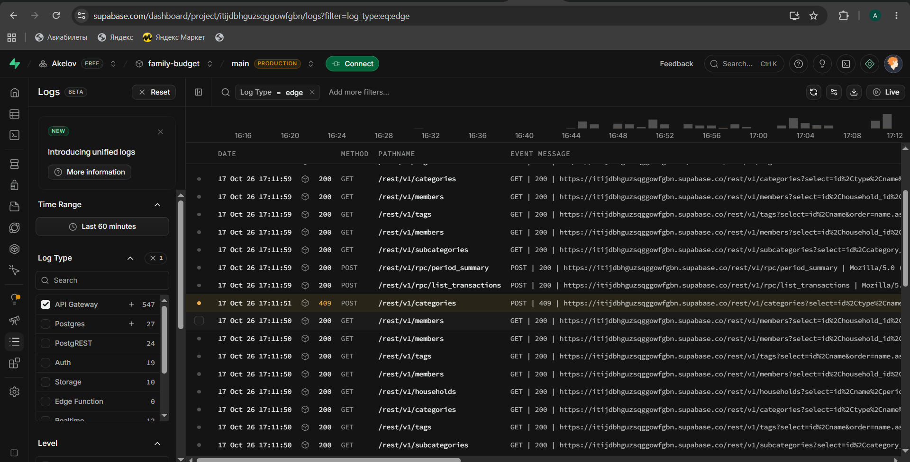

# Шаг 7. Обработка ошибок и логирование

## Идея простыми словами

Ошибки бывают **ожидаемые** (нет интернета, неправильно заполнено поле, нет прав,
такое название уже есть) и **неожиданные** (сбой сервера, ошибка в коде).

- Ожидаемые: пользователь видит понятное сообщение на русском, в журнал они не пишутся.
  Это обычная ситуация, а не поломка.
- Неожиданные: пользователь видит короткое «Не удалось загрузить данные» без технических
  подробностей, а полный текст ошибки уходит в **журнал ошибок** для разработчика.

Ошибки разбираются в трёх местах:

```text
1. База данных (PostgreSQL)   — проверяет данные и права, отвечает кодом ошибки
        │  код P0403, 23505, 23514 …
2. Сайт: toApiError()         — переводит код в понятный текст для пользователя
        │  неожиданная ошибка?
3. Журнал: logClientError()   — консоль браузера + таблица client_errors в Supabase
```

## 1. Ошибки на сервере

Функции базы сами проверяют входные данные и права и возвращают ошибку со своим кодом:

| Код | Когда | Что видит пользователь |
|-----|-------|------------------------|
| `P0401` | пользователь не вошёл | «Сессия истекла, войдите снова» → экран входа |
| `P0403`, `42501` | нет прав (RLS, роль) | «Недостаточно прав для этого действия» |
| `P0404` | запись не найдена (удалена другим участником) | «Операция удалена» |
| `P0409` | запись изменил другой участник | «Операция была изменена другим участником» |
| `23505` | повтор уникального названия | «Такая категория уже есть» / «Такой тег уже есть» |
| `23503` | удаление того, на что есть ссылки | «Нельзя удалить: есть связанные операции…» |
| `23514` | нарушена проверка (сумма ≤ 0, дата в будущем…) | текст проверки из базы, на русском |
| другой код, HTTP 5xx | сбой сервера | «Не удалось загрузить данные» + запись в журнал |
| нет ответа | нет интернета | «Нет соединения» |

Таблица соответствий — `src/shared/api/supabaseErrors.ts` (`CODE_MAP`).

## 2. Ошибки на сайте

| Ситуация | Как обрабатывается | Файл |
|----------|--------------------|------|
| Загрузка данных не удалась | экран показывает ошибку и кнопку «Повторить»; сеть и 5xx — 2 автоматических повтора (через 1 и 3 с) | `shared/api/useQuery.ts` |
| Сохранение не удалось | всплывающее сообщение, форма остаётся заполненной | формы фич |
| Сессия истекла | выход и переход на экран входа | `ReferenceDataProvider.tsx` |
| Упал один экран (ошибка в коде) | показывается «Раздел не загрузился», остальное приложение работает | `shared/ui/ErrorBoundary.tsx` |
| Ошибка вне React (обработчик, промис без `catch`) | перехват и запись в журнал | `shared/lib/globalErrors.ts` |

## 3. Журнал ошибок

`logClientError()` (`src/shared/lib/logger.ts`) делает две вещи:

1. пишет в консоль браузера JSON: уровень, время, экран, код, сообщение;
2. добавляет строку в таблицу Supabase `client_errors`.

Что попадает в журнал:

| Код записи | Откуда |
|------------|--------|
| `db_<код>` | неизвестная ошибка базы или HTTP 5xx — с исходным текстом базы |
| `ui_crash` | упал экран (ErrorBoundary) |
| `uncaught`, `unhandled_rejection` | ошибка вне React |
| `load_failed` | ошибка при разборе ответа сервера |
| `test_entry` | проверочная запись (Настройки → Для разработчика) |

Защита и ограничения:

- **Нет личных данных.** В журнал попадают только экран, код и техническое сообщение;
  суммы, комментарии и имена не передаются.
- **Пользователи журнал не читают.** По правилам RLS участник может только *добавить*
  запись, а прочитать — нет. Журнал видит только владелец проекта в панели Supabase.
- **Лимит:** не больше 20 записей за загрузку страницы, чтобы ошибка в цикле не засыпала таблицу.
- **Сбой записи в журнал не ломает сайт:** такая ошибка просто игнорируется.

## 4. Логи самого Supabase

Кроме нашей таблицы, Supabase сам ведёт журналы (раздел **Logs & Analytics**):

| Журнал | Что в нём |
|--------|-----------|
| **API Gateway** | каждый запрос сайта: адрес, метод, код ответа (200, 401, 409 …), время |
| **Postgres** | ошибки базы: нарушенные ограничения, отказ в доступе |
| **Auth** | вход, регистрация, подтверждение почты, ошибки входа |

## Как проверить

1. На сайте: Настройки → «Для разработчика» → «Отправить проверочную запись».
   В Supabase: Table Editor → `client_errors` — появилась строка `test_entry`.
2. Повтор названия проверяется **дважды**: сначала на сайте (в форме сразу появится
   «Такое название уже есть», запрос даже не уходит), затем в базе — на случай, если сайт
   не успел узнать о новой категории. Проверить вторую защиту:
   - откройте сайт в двух вкладках, в обеих — Настройки → Категории → «Новая категория»;
   - в первой вкладке создайте категорию «Тест ошибки»;
   - во второй (она ещё не знает о новой категории) создайте такую же «Тест ошибки».
   Сайт покажет «Такая категория уже есть», но уже по ответу базы. В Supabase: Logs →
   API Gateway → слева фильтр **Level** → Warning — запрос `POST /rest/v1/categories`
   с кодом **409**; в Postgres — `duplicate key value violates unique constraint`.
   Результат на сервере (строка 17:11:51, код 409 выделен жёлтым):

   

3. Logs & Analytics → Auth — видны ваши входы и регистрации.

SQL для просмотра журнала (SQL Editor):

```sql
select created_at, screen, code, message
from public.client_errors
order by created_at desc
limit 20;
```

## Тесты

| Файл | Что проверяет |
|------|---------------|
| `shared/api/supabaseErrors.test.ts` | коды базы → поведение; неизвестная ошибка уходит в журнал, ожидаемые — нет |
| `shared/lib/logger.test.ts` | формат записи, демо-режим, лимит 20 записей |
| `shared/lib/globalErrors.test.ts` | перехват `error` и `unhandledrejection`, отключение |
| `shared/lib/currentScreen.test.ts` | имя экрана из адреса страницы |
