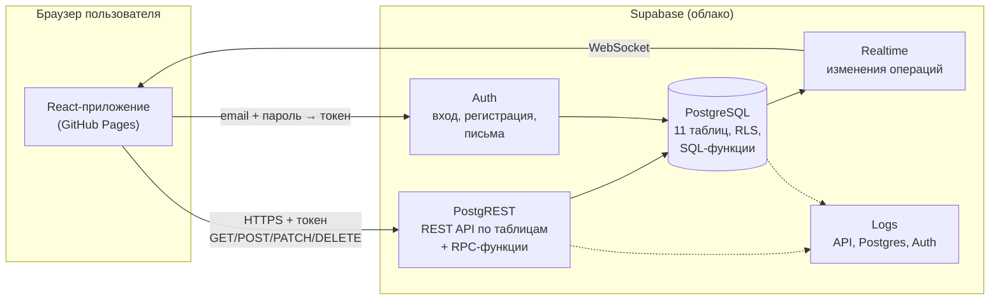

# Backend «Семейного бюджета»: документация

ДЗ5 «Развёртывание Backend и интеграция с Frontend».

| | |
|---|---|
| **Приложение** | https://akelov.github.io/family-budget/ |
| **Репозиторий** | https://github.com/Akelov/family-budget |
| **Backend** | Supabase (бесплатный тариф), проект `family-budget`, регион Central EU (Frankfurt) |
| **API** | `https://itijdbhguzsqggowfgbn.supabase.co` — REST `/rest/v1`, вход `/auth/v1`, Realtime |

Подробности по каждому шагу задания:

| Шаг | Документ |
|-----|----------|
| 1. Проектирование базы данных | [01_database.md](01_database.md) — ER-диаграмма, 11 таблиц, связи |
| 2. Выбор инфраструктуры | [02_infrastructure.md](02_infrastructure.md) — Supabase против своего сервера |
| 3. Развёртывание базы | [03_deploy.md](03_deploy.md), методичка проверки [check_database.md](check_database.md) |
| 4. Создание API | [04_api.md](04_api.md) |
| 5. Безопасность | [05_security.md](05_security.md) — RLS, вход, проверка на сервере |
| 6. Интеграция Frontend | [06_integration.md](06_integration.md) |
| 7. Ошибки и логирование | [07_errors_logging.md](07_errors_logging.md) |
| 8. Тестирование API | [08_api_testing.md](08_api_testing.md) — 70 проверок |
| Памятка по отладке | [debug_playbook.md](debug_playbook.md) — 10 частых проблем, команды и промпты |

---

## 1. Архитектура



**Как это работает простыми словами.** Своего сервера у приложения нет: сайт — это набор
файлов на GitHub Pages, который работает в браузере. Все данные хранятся в базе PostgreSQL
в Supabase. Supabase сам даёт:

- **Auth** — регистрацию и вход по email и паролю. После входа браузер получает токен
  (JWT), в котором записан id пользователя;
- **REST API** — для каждой таблицы автоматически есть адрес `/rest/v1/<таблица>`, а наши
  SQL-функции вызываются через `/rest/v1/rpc/<функция>`;
- **Realtime** — когда один член семьи добавляет операцию, у другого она появляется сразу.

**Кто что может — решает сама база**, а не сайт. Каждая таблица защищена правилами
Row Level Security (RLS): база по токену узнаёт пользователя и отдаёт только данные его
семьи. Поэтому даже если кто-то напишет запрос в обход сайта, чужих данных он не получит.

### Слои приложения

```text
Компонент (экран)                    — только показывает данные
  └─ хук (useTransactions, …)          — загрузка, ошибка, повторы, обновление
       └─ features/<фича>/api/<фича>Api.ts — фасад: Supabase или демо-режим
            ├─ *.supabase.ts            — запросы к Supabase (supabase-js)
            └─ *.mock.ts                — демо на мок-данных (без ключей)
```

| Что | Где |
|-----|-----|
| Миграции базы (4 файла, применяются по порядку) | `supabase/migrations/` |
| Локальная проверка миграций и API на PostgreSQL 16 | `supabase/local/` |
| Скрипт проверки всех запросов | `supabase/tests/endpoints_check.sql` |
| Клиент Supabase, разбор ошибок и ответов | `src/shared/api/supabase*.ts` |
| Вход и регистрация | `src/features/auth/` |
| Журнал ошибок | `src/shared/lib/logger.ts`, таблица `client_errors` |
| Пример переменных окружения | `.env.example` |

### Модель данных

11 таблиц: `households` (семья), `members` (участник, роли `owner` / `admin` / `member`),
`invites` (приглашения), `categories` и `subcategories`, `transactions` (операция),
`tags` и `transaction_tags`, `budgets` и `budget_items`, `client_errors` (журнал).
Связи и поля — [01_database.md](01_database.md).

Принятые решения:

- **Деньги** — `numeric(12,2)` в базе, на сайте и в ответах функций — копейки (целые числа),
  чтобы не было ошибок округления `0.1 + 0.2`.
- **Удаление операции мягкое** (`deleted_at`) — работает кнопка «Отменить».
- **id операции создаёт сайт** — повторная отправка при плохой связи не создаёт дубль.
- **Проверка конфликта** — при изменении сервер сравнивает `updated_at`: если операцию
  уже изменил другой участник, изменение не перезапишет его правку.

---

## 2. Развёртывание

### 2.1. База данных в Supabase

1. Зарегистрироваться на [supabase.com](https://supabase.com) и создать проект
   (тариф Free, ближайший регион). Пароль базы сохранить у себя — в репозиторий он не нужен.
2. **SQL Editor** → по очереди вставить и выполнить (Run) 5 миграций из `supabase/migrations/`:

   | № | Файл | Что создаёт |
   |---|------|-------------|
   | 1 | `20261017120000_schema.sql` | таблицы, ограничения, триггеры целостности, включает RLS |
   | 2 | `20261017130000_api_functions.sql` | серверные функции (RPC) |
   | 3 | `20261017140000_rls_policies.sql` | правила доступа RLS, закрывает доступ гостю |
   | 4 | `20261017150000_app_integration.sql` | выход из семьи, удаление семьи, объединение тегов, Realtime |
   | 5 | `20261017160000_security_hardening.sql` | закрывает функции от гостя, закрепляет `search_path` (ДЗ6, Security Advisor) |

   Если Supabase предупредит о «destructive operations» — это нормально (миграции удаляют
   старые права), подтвердить запуск.
3. **Authentication → Sign In / Providers → Email:** вход по email включён,
   «Confirm email» включено (письмо-подтверждение обязательно).
4. **Authentication → URL Configuration:**
   - Site URL: `https://akelov.github.io/family-budget/`
   - Redirect URLs: `https://akelov.github.io/family-budget/**` (и `http://localhost:5173/**`
     для локальной разработки).
5. **Project Settings → API Keys:** скопировать адрес проекта и **публичный** ключ
   `sb_publishable_…` (он же `anon`). Ключ `sb_secret_…` / `service_role` никуда не копировать.
6. Проверка: **SQL Editor** → содержимое `supabase/tests/endpoints_check.sql` → Run.
   Ожидается 76 строк с ✅ ([08_api_testing.md](08_api_testing.md)).

### 2.2. Сайт на своём компьютере

Нужен Node.js 22 LTS.

```bash
git clone https://github.com/Akelov/family-budget.git
cd family-budget
npm install
cp .env.example .env.local      # и вписать адрес проекта и публичный ключ
npm run dev                     # http://localhost:5173
```

`.env.local`:

```bash
VITE_BASE=/
VITE_SUPABASE_URL=https://<project-ref>.supabase.co
VITE_SUPABASE_ANON_KEY=sb_publishable_...
```

Файл `.env.local` в `.gitignore` и в репозиторий не попадает. Без него сайт запускается
в **демо-режиме** на мок-данных (как в ДЗ4).

### 2.3. Публикация на GitHub Pages

1. Репозиторий → **Settings → Secrets and variables → Actions → Variables** → две переменные:
   `VITE_SUPABASE_URL` и `VITE_SUPABASE_ANON_KEY`.
2. **Settings → Pages → Source: GitHub Actions** (один раз).
3. Каждый push в `main` запускает [CI](../../.github/workflows/ci.yml): линтер → проверка
   типов → тесты → сборка с этими переменными → публикация. Пересобрать вручную:
   **Actions → последний запуск → Re-run all jobs**.

### 2.4. Проверка миграций без облака (для разработчика)

```bash
# нужен PostgreSQL 16 на порту 54329
bash supabase/local/run_all.sh        # заглушка auth + все миграции в базу fb
psql -h /tmp -p 54329 -U postgres -d fb -f supabase/tests/endpoints_check.sql
```

---

## 3. API endpoints

Все запросы — к `https://itijdbhguzsqggowfgbn.supabase.co`. Обязательные заголовки:

| Заголовок | Значение |
|-----------|----------|
| `apikey` | публичный ключ `sb_publishable_…` — какой проект |
| `Authorization` | `Bearer <access_token>` — кто вошёл (без него запрос идёт как гость и отклоняется) |
| `Content-Type` | `application/json` для POST и PATCH |

Сайт не пишет эти запросы вручную: их формирует библиотека `@supabase/supabase-js`.

### 3.1. Вход (Supabase Auth)

| Метод и адрес | supabase-js | Что делает |
|---------------|-------------|-----------|
| `POST /auth/v1/signup` | `auth.signUp` | регистрация, отправляет письмо-подтверждение |
| `POST /auth/v1/token?grant_type=password` | `auth.signInWithPassword` | вход, возвращает `access_token` |
| `POST /auth/v1/recover` | `auth.resetPasswordForEmail` | письмо для сброса пароля |
| `PUT /auth/v1/user` | `auth.updateUser` | новый пароль |
| `POST /auth/v1/logout` | `auth.signOut` | выход |

### 3.2. Таблицы (REST, CRUD)

`GET` — чтение, `POST` — создание, `PATCH` — изменение, `DELETE` — удаление.
Фильтры в адресе: `?id=eq.<id>`, `?select=поля`, `?order=name.asc`.

| Адрес | Методы | Кто может (RLS) |
|-------|--------|-----------------|
| `/rest/v1/households` | GET, PATCH | читать — участники семьи; менять — владелец и администратор |
| `/rest/v1/members` | GET, PATCH | читать — участники; своё имя и период — каждый; роли — только владелец |
| `/rest/v1/categories` | GET, POST, PATCH, DELETE | читать — участники; менять — владелец и администратор |
| `/rest/v1/subcategories` | GET, POST, PATCH, DELETE | так же, как категории |
| `/rest/v1/tags` | GET, PATCH, DELETE | читать — участники; переименовать, удалить — владелец и администратор |
| `/rest/v1/budgets`, `/rest/v1/budget_items` | GET, POST, PATCH, DELETE | читать — участники; менять — владелец и администратор |
| `/rest/v1/transactions` | GET | только чтение; запись — только через функции ниже |
| `/rest/v1/client_errors` | POST | вошедший пользователь только добавляет; читать нельзя никому |

### 3.3. Серверные функции (RPC) — `POST /rest/v1/rpc/<имя>`

Параметры передаются JSON-объектом; суммы — в копейках.

| Функция | Параметры | Ответ | Ошибки |
|---------|-----------|-------|--------|
| `create_household` | `p_name`, `p_display_name` | семья; вы владелец; 15 категорий и 42 подкатегории | P0401, P0403 (уже в семье), 23514 |
| `create_invite` | `p_role` (`admin` / `member`) | приглашение с `token` | P0403 (не владелец) |
| `accept_invite` | `p_token`, `p_display_name` | новый участник | P0404 (ссылка недействительна), P0403 |
| `my_household_id` | — | id семьи или `null` | — |
| `list_transactions` | `p_from`, `p_to`, фильтры, `p_offset`, `p_limit` | операции порциями по 50 | — |
| `period_summary` | `p_from`, `p_to`, фильтры | `income`, `expense`, `balance` | — |
| `create_transaction` | `p_id`, `p_type`, `p_amount`, `p_subcategory_id`, `p_date`, `p_comment`, `p_tags` | id операции | 23514 (сумма, дата, тип, теги), P0403 |
| `update_transaction` | `p_id`, `p_expected_updated_at`, … | новое `updated_at` | P0409 (изменил другой), P0403, P0404 |
| `delete_transaction` / `restore_transaction` | `p_id` | — | P0403, P0404 |
| `report_by_category` | `p_from`, `p_to`, `p_type` | `category_id`, `amount` | — |
| `report_by_subcategory` | `p_from`, `p_to`, `p_category_id` | `subcategory_id`, `amount` | — |
| `report_by_tag` | `p_from`, `p_to`, `p_type` | `tag_id`, `amount` | — |
| `budget_status` | `p_from`, `p_to` | `budget_id`, `amount`, `spent` | — |
| `merge_tags` | `p_from`, `p_into` | — | P0403, P0404, 23514 |
| `leave_household` | — | — | P0403 (владелец не может выйти) |
| `delete_household` | — | — | P0403 (не владелец) |

Функции записи работают с правами владельца базы (`SECURITY DEFINER`) и **сами проверяют**
пользователя и его роль. Функции чтения работают с правами пользователя — их защищает RLS.
Гость (`anon`) не может вызвать ни одну функцию.

### 3.4. Realtime

Канал `household-<id>`: подписка на изменения таблицы `transactions`. RLS действует и здесь —
события приходят только участникам своей семьи. Сайт по событию перезагружает список и отчёты.

### 3.5. Коды ошибок

| Код | HTTP | Значение | Что видит пользователь |
|-----|------|----------|------------------------|
| `P0401` | 400 | не выполнен вход | переход на экран входа |
| `P0403`, `42501` | 400 / 401 / 403 | нет прав | «Недостаточно прав для этого действия» |
| `P0404` | 400 | не найдено | «Операция удалена» |
| `P0409` | 400 | изменил другой участник | «Операция была изменена другим участником» |
| `23505` | 409 | дубликат | «Такая категория уже есть» |
| `23503` | 409 | есть связанные записи | «Нельзя удалить: есть связанные операции» |
| `23514` | 400 | неверные данные | текст проверки, например «Дата не может быть в будущем» |
| `PGRST301` | 401 | неверный или просроченный токен | переход на экран входа |
| 5xx / нет ответа | — | сбой сервера / нет сети | «Не удалось загрузить данные» / «Нет соединения», 2 повтора |

---

## 4. Примеры запросов

### 4.1. Из кода сайта (supabase-js)

```ts
// Вход
await supabase().auth.signInWithPassword({ email, password });

// Чтение таблицы: категории своей семьи (RLS отфильтрует чужие)
const { data, error } = await supabase()
  .from('categories')
  .select('id, type, name, color, icon, archived_at')
  .order('name');

// Создание операции через функцию: 1 500,00 ₽ = 150000 копеек
await supabase().rpc('create_transaction', {
  p_id: crypto.randomUUID(),
  p_type: 'expense',
  p_amount: 150000,
  p_subcategory_id: subcategoryId,
  p_date: '2026-10-17',
  p_comment: 'Продукты на неделю',
  p_tags: ['Дача'],
});

// Отчёт: расходы по категориям за октябрь
const { data: rows } = await supabase().rpc('report_by_category', {
  p_from: '2026-10-01', p_to: '2026-10-31', p_type: 'expense',
});
```

### 4.2. HTTP (curl)

Вход — получить токен (данные тестового аккаунта):

```bash
curl -X POST "$URL/auth/v1/token?grant_type=password" \
  -H "apikey: $ANON_KEY" -H "Content-Type: application/json" \
  -d '{"email":"test@example.com","password":"<пароль>"}'
# → {"access_token":"eyJ…","token_type":"bearer","expires_in":3600,"user":{…}}
```

Чтение, создание, изменение, удаление (CRUD) с токеном:

```bash
H=(-H "apikey: $ANON_KEY" -H "Authorization: Bearer $TOKEN" -H "Content-Type: application/json")

curl "$URL/rest/v1/categories?select=id,name&type=eq.expense" "${H[@]}"              # Read
curl -X POST "$URL/rest/v1/budgets" "${H[@]}" -H "Prefer: return=representation" \
  -d '{"household_id":"<id>","name":"Продукты","amount":30000}'                   # Create
curl -X PATCH "$URL/rest/v1/budgets?id=eq.<id>" "${H[@]}" -d '{"amount":35000}'    # Update
curl -X DELETE "$URL/rest/v1/budgets?id=eq.<id>" "${H[@]}"                          # Delete

curl -X POST "$URL/rest/v1/rpc/period_summary" "${H[@]}" \
  -d '{"p_from":"2026-10-01","p_to":"2026-10-31"}'
# → [{"income":8000000,"expense":260000,"balance":7740000}]
```

Тот же запрос без входа — реальный ответ сервера:

```bash
curl -X POST "$URL/rest/v1/rpc/list_transactions" -H "apikey: $ANON_KEY" \
  -H "Content-Type: application/json" -d '{"p_from":"2026-10-01","p_to":"2026-10-17"}'
# HTTP 401
# {"code":"42501","message":"permission denied for function list_transactions"}
```

Ошибка данных — дата в будущем:

```bash
curl -X POST "$URL/rest/v1/rpc/create_transaction" "${H[@]}" \
  -d '{"p_id":"…","p_type":"expense","p_amount":100,"p_subcategory_id":"…","p_date":"2030-01-01"}'
# HTTP 400 {"code":"23514","message":"Дата не может быть в будущем"}
```

Больше ответов настоящего сервера — [08_api_testing.md](08_api_testing.md#уровень-3-http-запросы-гостя-к-настоящему-серверу).

---

## 5. Безопасность

| Требование | Как сделано |
|------------|-------------|
| Аутентификация | Supabase Auth: регистрация с подтверждением почты, вход, сброс пароля, выход. Страницы приложения без входа недоступны (`RequireAuth`) |
| Политики доступа | RLS на всех 11 таблицах по матрице прав ТЗ §3.2; гость (`anon`) лишён прав на все таблицы и функции; функции записи проверяют роль сами |
| Защита от подмены роли | триггер `guard_member_update` не даёт участнику повысить себе роль или сменить семью |
| Секреты | в браузере только публичный ключ; `.env.local` в `.gitignore`; онлайн-сборка берёт ключи из переменных GitHub; пароль базы и `service_role` нигде не хранятся |
| CORS | Supabase отвечает `Access-Control-Allow-Origin: *` и разрешает заголовки `apikey, authorization` — проверено запросом `OPTIONS` с `Origin: https://akelov.github.io`. Это безопасно: доступ к данным даёт не адрес сайта, а токен входа и RLS. Адреса, куда ведут письма входа, ограничены списком Redirect URLs |
| Личные данные в логах | журнал ошибок не содержит сумм, комментариев и имён; читать его могут только администраторы проекта |

Проверка на сервере — [05_security.md](05_security.md) (другой пользователь видит 0 строк,
гость получает `permission denied`) и [08_api_testing.md](08_api_testing.md).

---

## 6. Тестирование

| Уровень | Результат |
|---------|-----------|
| Unit-тесты сайта (Vitest + Testing Library) | 25 файлов, 119 тестов ✅ |
| Скрипт проверки API: каждая функция и таблица, 4 пользователя и гость, норма / неверные данные / нет прав | 70 из 70 ✅ — на локальной копии и на сервере Supabase |
| HTTP-запросы гостя к настоящему серверу | все отклонены (401) ✅ |
| Ручная проверка на сайте: регистрация, семья, операции, приглашение второго участника, ошибка 409 в логах | ✅ (скриншоты в [07_errors_logging.md](07_errors_logging.md)) |
| CI: линтер, типы, тесты, сборка при каждом push | ✅ |

---

## 7. Процесс разработки с AI

Работа шла в паре: **владелец продукта** (студент) и **AI-агент Claude**. Правила агента —
[CLAUDE.md](../../CLAUDE.md): стек, запрет `any`, деньги в копейках, обязательные тесты,
запрет секретов в коде, запрет обходить RLS.

| Кто | Что делал |
|-----|-----------|
| Владелец продукта | ставил задачу по шагам, создал проект Supabase, выполнял миграции и проверки в SQL Editor, настраивал Auth и переменные GitHub, проверял сайт, присылал скриншоты логов и ошибок |
| AI-агент | проектировал схему по ТЗ, писал миграции, функции, RLS, код интеграции, тесты, скрипт проверки API, документацию; проверял каждую миграцию на локальном PostgreSQL 16 до отправки на сервер; находил причины ошибок по логам |

Агенту **не давали** пароль базы и секретный ключ: всё, что требует прав владельца проекта,
выполнял человек в панели Supabase. Это правило 17 CLAUDE.md в действии.

### Как AI использовался на каждом шаге

| Шаг | Промпт (кратко, структура RTCF из ДЗ2) | Что получилось |
|-----|----------------------------------------|----------------|
| 1. База данных | «Ты — backend-разработчик. По ТЗ (FR-1…FR-7, роли §3.2) спроектируй схему PostgreSQL: сущности, связи, поля, ограничения. Деньги — numeric(12,2). Формат: ER-диаграмма + миграция SQL.» | 11 таблиц, триггеры целостности (подкатегория своей семьи, тип операции = тип категории, дата не в будущем) |
| 2. Инфраструктура | «Сравни Supabase и PostgreSQL в Docker на VPS для семейного приложения: стоимость, вход, API, безопасность, администрирование.» | выбран Supabase |
| 4. API | «Создай RPC для операций: идемпотентное создание по id клиента, изменение с проверкой updated_at, мягкое удаление. Ошибки — свои коды P04xx с текстом на русском.» | функции для операций, отчётов, бюджетов и приглашений |
| 5. Безопасность | «Напиши политики RLS по матрице прав ТЗ §3.2. Гостю — ничего. Проверь от имени разных пользователей.» | политики + страж-триггер ролей + методичка проверки |
| 6. Интеграция | «Замени мок-API на Supabase, не меняя компоненты: фасад выбирает реализацию по переменным окружения. Без any, ответы — unknown с сужением типов.» | фасады, вход, приглашения, Realtime |
| 7. Логи | «Вот строка журнала Postgres: `permission denied for table client_errors`. Найди причину.» | найдена запись в журнал от гостя, исправлено |
| 8. Тесты | «Составь проверку всех endpoints: норма, неверные данные, нет прав; от имени 4 пользователей и гостя; без изменений в базе.» | скрипт на 70 проверок с откатом |

### Проблемы, найденные и исправленные с помощью AI

| Проблема | Как нашли | Исправление |
|----------|-----------|-------------|
| Удаление семьи падало: `violates foreign key constraint "budget_items_category_id_fkey"` | локальная проверка миграций на PostgreSQL 16 | функция `delete_household()` удаляет данные в правильном порядке |
| Участник не мог выйти из семьи: страж-триггер запрещал менять `removed_at` | тест сценария «выйти из семьи» | триггер разрешает участнику пометить выбывшим только себя |
| В SQL Editor нет переключателя пользователя для проверки RLS | вопрос владельца продукта по скриншоту | проверка через `request.jwt.claims` + `set local role authenticated` ([check_database.md](check_database.md)) |
| Подсказка Supabase `GRANT SELECT … TO anon` при ошибке доступа | скриншот владельца | объяснено, что выполнять нельзя: ошибка — правильная защита |
| Ошибки TypeScript в ответах RPC supabase-js | `npm run typecheck` | типизированные помощники с `unknown` и проверкой полей (`supabaseRpc.ts`) |
| Письмо подтверждения вело бы на `localhost:3000` | разбор настроек Auth | Site URL и Redirect URLs, `emailRedirectTo` при регистрации |
| `permission denied for table client_errors` в журнале Postgres | анализ логов Supabase (шаг 7) | гость не пишет в журнал, проверка сессии в `logger.ts` |
| Ожидание ошибки для пользователя без семьи не совпало с ответом | скрипт проверки API (шаг 8) | разобрано: чтение защищено RLS и отдаёт пустой список — так и задумано; добавлена проверка на запись |
| Дубликат категории не доходил до сервера — 409 не было в логах | проверка владельцем продукта | объяснено: две защиты (форма и база); проверка второй — через две вкладки |

### Памятка по отладке

Итог занятия — [debug_playbook.md](debug_playbook.md): 10 частых проблем бэкенда с командами
диагностики и готовыми промптами для AI-агента.
