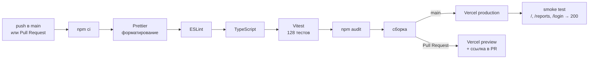

# Шаг 1. CI/CD: GitHub Actions + Vercel

## Что выбрано и почему

| Задача | Решение | Почему |
|--------|---------|--------|
| Платформа CI/CD | **GitHub Actions** | код уже на GitHub, бесплатно для публичного репозитория, пайплайн хранится в репозитории ([.github/workflows/ci.yml](../../.github/workflows/ci.yml)) |
| Хостинг сайта | **Vercel** (тариф Hobby) | создан для фронтенд-проектов на Vite/React, HTTPS и CDN из коробки, превью для Pull Request, откат версии одной кнопкой |
| Кто публикует | **пайплайн**, а не Vercel сам | сайт обновляется **только после всех проверок**; в `vercel.json` автосборка Vercel выключена (`git.deploymentEnabled: false`) |

GitHub Pages (ДЗ4–ДЗ5) выключен: у сайта один адрес — https://family-budget-sable-nu.vercel.app

## Схема пайплайна

| Этап | Команда | Что ловит |
|------|---------|-----------|
| Установка зависимостей | `npm ci` | ровно те версии, что в `package-lock.json` |
| Форматирование | `npm run format:check` | код не по правилам Prettier (CLAUDE.md, правило 13) |
| Линтинг | `npm run lint` | ошибки и опасные конструкции (ESLint, typescript-eslint strict) |
| Типы | `npm run typecheck` | ошибки типов TypeScript (strict, без `any`) |
| Тесты | `npm test` | сломанная логика: деньги, отчёты, ошибки API, вход |
| Аудит зависимостей | `npm audit --audit-level=high` | библиотеки с известными уязвимостями |
| Сборка | `npm run build` | проект не собирается |
| Деплой production | `vercel pull` → `vercel build --prod` → `vercel deploy --prebuilt --prod` | — |
| Smoke test | `curl` трёх страниц | сайт не открывается после публикации |

Дополнительно:

- `concurrency` — новый запуск для той же ветки отменяет старый: на сайт уходит последняя версия;
- версия Vercel CLI зафиксирована (`vercel@61.1.0`);
- пайплайн сам создаёт проект на Vercel при первом запуске (`vercel project add` + `vercel link`),
  поэтому подключать GitHub к Vercel не нужно;
- [Dependabot](../../.github/dependabot.yml) раз в неделю предлагает обновления библиотек и
  GitHub Actions — каждое обновление проходит тот же пайплайн.

## Секреты и переменные

| Где | Имя | Что это | Секрет? |
|-----|-----|---------|---------|
| GitHub → Secrets | `VERCEL_TOKEN` | токен доступа к Vercel для публикации | **да** — хранится только в GitHub, в коде и логах его нет |
| GitHub → Variables | `VITE_SUPABASE_URL` | адрес проекта Supabase | нет, публичный |
| GitHub → Variables | `VITE_SUPABASE_ANON_KEY` | публичный ключ Supabase | нет, публичный |

## Как настроить с нуля

1. Зарегистрироваться на vercel.com (любым способом, тариф Hobby).
2. Account Settings → Tokens → **Create Token** (`github-actions`, срок 90 дней).
3. GitHub → Settings → Secrets and variables → Actions → **Secrets** → `VERCEL_TOKEN`.
4. Там же, вкладка **Variables** — `VITE_SUPABASE_URL` и `VITE_SUPABASE_ANON_KEY`.
5. Push в `main` — пайплайн создаст проект на Vercel и опубликует сайт.
6. Supabase → Authentication → URL Configuration: Site URL и Redirect URLs = адрес Vercel.

## Проверка на тестовом коммите

Первый запуск 17.10.2026 (коммит «CI/CD: деплой на Vercel только по токену…»):

| Задача | Результат | Время |
|--------|-----------|-------|
| Проверки, тесты, сборка | ✓ | 53 с |
| Деплой на Vercel (production) | ✓ проект создан, сайт опубликован, smoke test 200 | 56 с |

Если любая проверка падает, задача «Деплой» не запускается — это видно во вкладке
Actions репозитория (красный крестик у этапа, жёлтый «skipped» у деплоя).
