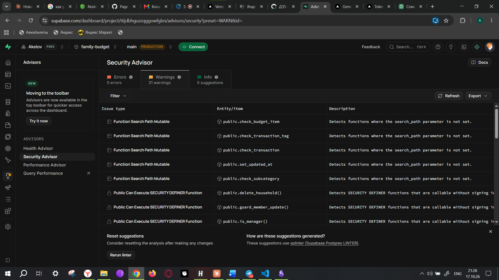
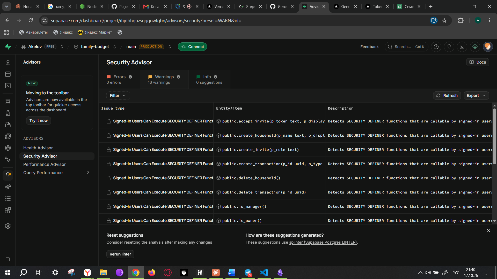

# Шаг 2. Аудит безопасности

Дата: 17.10.2026. Объект: репозиторий `Akelov/family-budget`, сайт на Vercel, проект Supabase.
Инструменты: `npm audit`, поиск опасных конструкций в коде (AI-агент Claude + `grep`),
проверка заголовков в браузере (Playwright), разбор по **OWASP Top 10 (2021)**,
Supabase Security Advisor, тесты на 70 запросов к API из ДЗ5.

## Итог

| № | Находка | Уровень | Статус |
|---|---------|---------|--------|
| 1 | `tinypool` ≤ 2.1.1 (через Vitest 3): Prototype Pollution → выполнение кода, GHSA-5gmw-xhrv-c9v3, GHSA-85c8-ppgw-ccpr | **критический** | ✅ исправлено: Vitest 3.2.7 → 4.1.11 |
| 2 | `@vitest/mocker` 2.1.0–4.1.10: чтение произвольных файлов (path traversal) | средний | ✅ исправлено тем же обновлением |
| 3 | Нет защитных HTTP-заголовков: CSP, защита от встраивания во фрейм (clickjacking), HSTS | средний | ✅ исправлено: заголовки в `vercel.json` |
| 4 | Минимальная длина пароля проверялась только на сайте (8), сервер Supabase принимал от 6 | средний | ✅ Supabase Auth: Minimum password length = 8 |
| 5 | Проверка `?next=` после входа пропускала `/\evil.example` (браузер читает как `//evil.example`) | низкий | ✅ исправлено: `safeRedirectPath` + 9 тестов |
| 6 | Сайт писал журнал ошибок от гостя — отказ базы попадал в логи (найдено в ДЗ5) | низкий | ✅ исправлено в ДЗ5 |
| 7 | Старая копия сайта на GitHub Pages перестала обновляться | низкий | ✅ публикация на GitHub Pages снята |
| 8 | Нет автоматического контроля новых уязвимостей в библиотеках | низкий | ✅ Dependabot + `npm audit` в пайплайне останавливает деплой |
| 9 | Сессия Supabase хранится в `localStorage` (доступна JavaScript страницы) | инфо | принято: стандарт supabase-js; риск XSS закрыт CSP и отсутствием `innerHTML` |
| 10 | GitHub Actions закреплены по мажорной версии (`@v5`), а не по хешу коммита | инфо | принято: официальные actions GitHub; обновления контролирует Dependabot |
| 11 | Проверка паролей по базе утечек (Leaked password protection) | инфо | недоступна на бесплатном тарифе Supabase |
| 12 | **Security Advisor:** функции миграций 3–4 (`delete_household`, `merge_tags`, `leave_household`, `is_manager`, …) мог вызвать гость — Supabase открывает новые функции ролям API по умолчанию. Остановить его могла только проверка внутри функции (P0401) | средний | ✅ миграция 5: права закрыты, плюс запрет по умолчанию для будущих функций |
| 13 | **Security Advisor:** у 5 триггерных функций не закреплён `search_path` (Function Search Path Mutable) | низкий | ✅ миграция 5 |
| 15 | **Dependabot alert #1:** Vitest `^3.2.0` (уязвимость `@vitest/mocker`, CVE-2026-84373, 5.9/10) в учебном примере ДЗ2 `docs/hw2/ab/with/package.json` — `npm audit` его не видел, т.к. проверяет только корневой проект | средний | ✅ пример обновлён до `^4.1.11`, его 26 тестов проходят, `npm audit` — 0 |
| 14 | Служебные функции (`require_household`, `editable_transaction`, …) можно было вызвать напрямую | низкий | ✅ миграция 5: доступны только изнутри других функций |

## 1. Зависимости (npm audit)

```text
до:    3 vulnerabilities (1 moderate, 2 critical)   — vitest, @vitest/mocker, tinypool
после: found 0 vulnerabilities
```

Уязвимые пакеты были **только в инструментах разработки** (тесты), в браузер они не попадают,
но выполняются на компьютере разработчика и в CI — поэтому исправлены.
Vitest 4 — новая мажорная версия; после обновления все 128 тестов проходят, изменился только
тип шпиона в одном тесте (`MockInstance<typeof console.error>`).

Чтобы проблема не вернулась:

- пайплайн выполняет `npm audit --audit-level=high` — уязвимость уровня high/critical
  **останавливает деплой**;
- [Dependabot](../../.github/dependabot.yml) раз в неделю открывает Pull Request с обновлениями
  библиотек и GitHub Actions;
- версии зависимостей в `package.json` закреплены точно (без `^`), `npm ci` ставит их из lock-файла.

## 2. Код по OWASP Top 10

| Риск OWASP | Что проверено | Результат |
|------------|---------------|-----------|
| **A01 Broken Access Control** | RLS на всех 11 таблицах, роли в функциях, 70 проверок API от 4 пользователей и гостя (ДЗ5); открытый редирект после входа | доступ к чужой семье невозможен на уровне базы; редирект исправлен (находка 5) |
| **A02 Cryptographic Failures** | HTTPS везде (Vercel, Supabase), пароли хранит Supabase Auth (bcrypt), секретов в коде нет | ✅; добавлен HSTS |
| **A03 Injection** (SQL, XSS) | в SQL-функциях нет динамического SQL (`EXECUTE`), параметры передаются отдельно от запроса (PostgREST, plpgsql); в React нет `dangerouslySetInnerHTML`, `innerHTML`, `eval` — весь текст экранируется | ✅ SQL-инъекция и XSS через данные невозможны; CSP — второй рубеж |
| **A04 Insecure Design** | идемпотентное создание операций, проверка конфликтов версий, мягкое удаление, проверки в базе (сумма > 0, дата не в будущем, подкатегория своей семьи) | ✅ |
| **A05 Security Misconfiguration** | заголовки ответа сайта; права роли `anon` в базе; подсказки Supabase `GRANT … TO anon` не выполнялись | заголовки добавлены (находка 3); `anon` без прав |
| **A06 Vulnerable Components** | `npm audit` | исправлено (находки 1, 2, 8) |
| **A07 Identification & Auth Failures** | подтверждение почты обязательно, сброс пароля по письму, длина пароля, ограничение частоты запросов Supabase Auth | длина пароля на сервере исправлена (находка 4) — исправлено |
| **A08 Software & Data Integrity** | `npm ci` по lock-файлу, деплой только из пайплайна после проверок, токен Vercel — секрет GitHub | ✅ |
| **A09 Logging & Monitoring Failures** | журнал `client_errors` без личных данных, логи Supabase API/Postgres/Auth | ✅ (ДЗ5, шаг 7); мониторинг — шаг 6 |
| **A10 SSRF** | у приложения нет сервера, который ходит по адресам от пользователя | не применимо |

**CSRF.** Вход подтверждается заголовком `Authorization: Bearer <токен>`, а не cookie.
Чужой сайт не может подставить этот заголовок в запрос, поэтому подделка межсайтового запроса
невозможна, отдельные CSRF-токены не нужны.

## 3. Защитные заголовки (vercel.json)

| Заголовок | Значение | От чего защищает |
|-----------|----------|------------------|
| `Content-Security-Policy` | скрипты только с нашего домена; запросы только к нашему проекту Supabase; шрифты Google; `frame-ancestors 'none'`; `object-src 'none'` | XSS: даже если злоумышленник вставит `<script>`, браузер его не выполнит и не отправит данные на чужой сервер |
| `X-Frame-Options: DENY` | — | clickjacking: сайт нельзя встроить в невидимый фрейм на чужой странице |
| `Strict-Transport-Security` | 2 года | браузер всегда открывает сайт только по HTTPS |
| `X-Content-Type-Options: nosniff` | — | браузер не «угадывает» тип файла (подмена скрипта под картинку) |
| `Referrer-Policy` | `strict-origin-when-cross-origin` | адреса страниц с параметрами не уходят на чужие сайты |
| `Permissions-Policy` | камера, микрофон, геолокация, платежи выключены | сторонний код не сможет запросить доступ к устройствам |
| `Cross-Origin-Opener-Policy` | `same-origin` | чужая вкладка не получит доступ к окну сайта |

Проверка: собранный сайт запущен локально с этими заголовками, в браузере (Playwright)
открыты страницы входа, регистрации, сброса пароля и приглашения — **0 нарушений CSP**.

## 4. Настройки сервисов

| Сервис | Настройка | Состояние |
|--------|-----------|-----------|
| Supabase Auth | подтверждение почты | включено (ДЗ5) |
| Supabase Auth | минимальная длина пароля | 8 символов, как на сайте |
| Supabase Auth | Site URL и Redirect URLs | только адрес Vercel |
| Supabase | роль `anon` | нет прав ни на одну таблицу и функцию |
| Supabase | Security Advisor | 31 предупреждение → 16 после миграции 5; оставшиеся — намеренные (см. ниже) |
| GitHub | Secret Protection и Push protection | включены — GitHub не даст отправить в репозиторий коммит с ключом или паролем |
| GitHub | `VERCEL_TOKEN` | в Secrets; в коде и логах пайплайна не появляется |
| Vercel | автосборка из Git | выключена — публикует только пайплайн после проверок |

## 5. Supabase Security Advisor

Встроенный анализатор Supabase (линтер `splinter`) нашёл 0 ошибок и 31 предупреждение:



| Предупреждение | Причина | Исправление |
|----------------|---------|-------------|
| Public Can Execute SECURITY DEFINER Function | миграция 2 закрыла от гостя только свои функции; функции миграций 3 и 4 Supabase открыл ролям `anon` и `authenticated` автоматически | `revoke execute … from public, anon` для всех функций и `alter default privileges` — чтобы новые функции не открывались сами |
| Function Search Path Mutable | у триггерных функций не задан `search_path` | `alter function … set search_path = public` |

**Как доказали и проверили** (правило 22 CLAUDE.md: сначала тест, потом исправление):

1. Локальная копия базы настроена так же, как Supabase: новые функции доступны ролям API
   по умолчанию (`supabase/local/supabase_grants.sql`).
2. В скрипт проверки API добавлены 6 проверок «гость / служебная функция → `42501`».
   До исправления **6 из 6 не прошли**: гость вызывал `delete_household` и получал
   `P0401` от проверки внутри функции, а `is_manager()` у гостя вообще выполнялась.
3. Миграция [20261017160000_security_hardening.sql](../../supabase/migrations/20261017160000_security_hardening.sql).
4. После неё — **76 из 76 ✅**; запрос к системному каталогу: роль `anon` не может
   выполнить ни одну функцию схемы `public`, у всех функций `SECURITY DEFINER` закреплён `search_path`.

После применения миграции на сервере и повторного запуска линтера: **31 → 16 предупреждений**,
все оставшиеся — одного вида:



Предупреждения «Signed-In Users Can Execute SECURITY DEFINER Function» для функций API
(`create_transaction`, `accept_invite` и т. п.) остаются **намеренно**: это и есть API для вошедших пользователей, каждая функция
сама проверяет семью и роль (70 проверок из ДЗ5).

## Как AI-агент проводил аудит

1. Запустил `npm audit`, по каждой уязвимости прочитал описание и диапазон версий,
   выбрал минимальное обновление вне диапазона (Vitest 4.1.11, а не «последнюю»).
2. При обновлении npm 10 падал с внутренней ошибкой (`Cannot read properties of null
   (reading 'edgesOut')`). Lock-файл пересобран npm 11, затем проверено, что `npm ci`
   на npm 10 (как в CI) ставит его без ошибок.
3. Прошёл по OWASP Top 10 с поиском опасных конструкций в коде (`innerHTML`, `eval`,
   динамический SQL, фильтры PostgREST со строкой пользователя, секреты в истории git).
4. Нашёл обход проверки редиректа через обратный слеш, вынес проверку в чистую функцию
   с тестами.
5. Составил CSP по фактическим адресам, к которым ходит сайт, и проверил её в браузере.
6. По скриншоту Security Advisor определил причину (права по умолчанию в Supabase), воспроизвёл
   её на локальной базе тестом, исправил миграцией и убедился, что тест стал зелёным.
