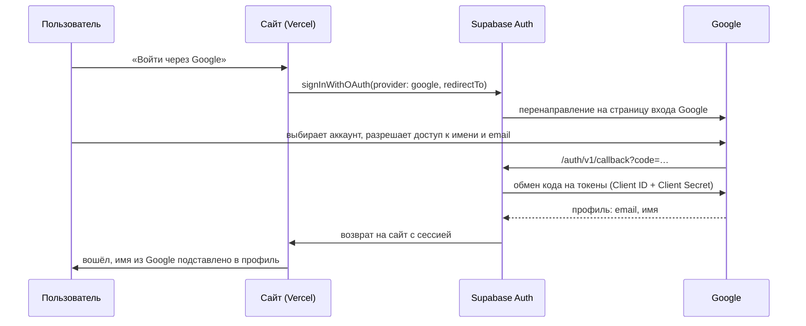
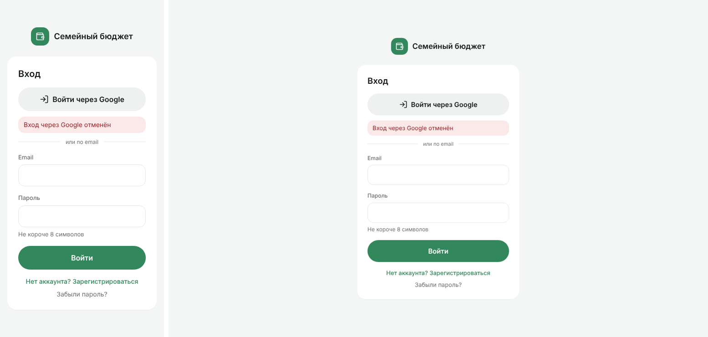

# Шаг 3. Вход через Google (OAuth 2.0)

## Как устроено

**Backend-часть flow выполняет Supabase Auth:** он хранит Client Secret, принимает код от Google
на адрес `https://<проект>.supabase.co/auth/v1/callback` и обменивает его на токены. Секрет
никогда не попадает в браузер, в код или в репозиторий (правило 17 CLAUDE.md).

## Настройка

| Где | Что сделано |
|-----|-------------|
| Google Cloud Console → Google Auth Platform | проект `family-budget`; экран согласия (External, название «Семейный бюджет»); тестовые пользователи; клиент **Web application** |
| Google — Authorized JavaScript origins | `https://family-budget-sable-nu.vercel.app` |
| Google — Authorized redirect URIs | `https://itijdbhguzsqggowfgbn.supabase.co/auth/v1/callback` |
| Supabase → Authentication → Sign In / Providers → Google | включён; Client ID и Client Secret из Google |
| Supabase → URL Configuration | Redirect URLs `https://family-budget-sable-nu.vercel.app/**` — куда можно вернуть после входа |

## Код

| Файл | Что делает |
|------|-----------|
| `features/auth/api/authApi.ts` — `signInWithGoogle(next)` | запускает вход; адрес возврата только внутри сайта (`safeRedirectPath`); `prompt=select_account` — выбор аккаунта |
| `features/auth/components/GoogleSignIn.tsx` | кнопка «Войти через Google» и разделитель на экранах входа и регистрации |
| `features/auth/model/oauth.ts` | `profileFromUser` — имя и способ входа из метаданных Google (`unknown` + проверка типов); `oauthErrorFromUrl` — ошибка возврата из Google |
| `features/auth/components/AuthProvider.tsx` | хранит имя и способ входа; ошибку из адреса читает один раз при запуске |
| `pages/OnboardingPage.tsx` | имя участника по умолчанию — из аккаунта Google |
| `settings/components/AccountCard.tsx` | «email · вход через Google» |

## Проверка

| Сценарий | Результат |
|----------|-----------|
| Успешный вход через Google | ✅ пользователь вернулся на сайт вошедшим (проверил владелец продукта) |
| Получение данных пользователя | ✅ email и имя из Google: имя подставлено при создании семьи, в Настройках «вход через Google» |
| Провайдер выключен в Supabase | Supabase ответил `400 Unsupported provider: provider is not enabled` — найдено при первой проверке, исправлено включением Google в Supabase |
| Пользователь нажал «Отмена» у Google | на экране входа «Вход через Google отменён» (тест `oauth.test.ts`, скриншот ниже) |
| Сбой у Google / Supabase | «Не удалось войти через Google. Попробуйте ещё раз или войдите по email» — без технических подробностей |
| Вход через Google по ссылке-приглашению | ✅ Google-аккаунт присоединился к существующей семье |
| Тесты | `oauth.test.ts` (6), `GoogleSignIn.test.tsx` (3): запуск входа, ошибка запуска, ошибка возврата |

Найдено при проверке: вход через Google с **другим email** создаёт отдельный аккаунт без семьи,
и владелец продукта по привычке создал вторую семью. Это корректное поведение (разные email —
разные люди), но на экран «Создайте семью» добавлена подсказка: попросить приглашение, а не
создавать новую семью. Если email совпадает с уже подтверждённым аккаунтом, Supabase
объединяет оба способа входа в один аккаунт автоматически.

Попутно по скриншоту найдена и исправлена ошибка вёрстки из ДЗ4: «растянутые» кнопки в
колонке (форма входа) сплющивались по высоте (`flex-1` → `grow` в `Button.tsx`).
