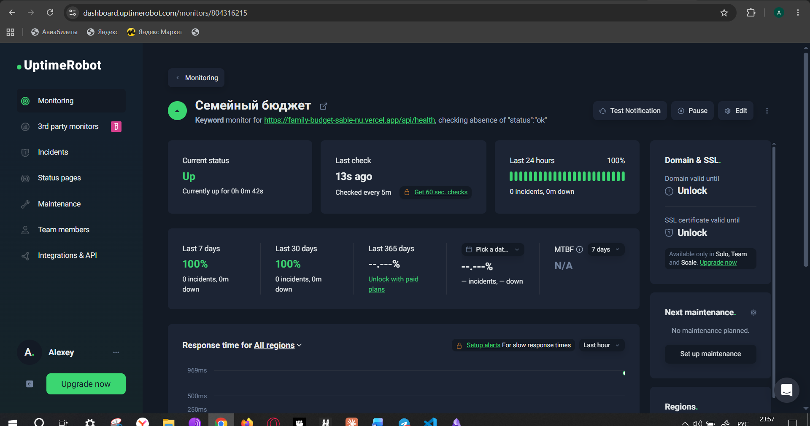

# Шаг 6. Мониторинг

## Что и чем отслеживаем

| Что | Чем | Как часто | Тревога |
|-----|-----|-----------|---------|
| Сайт, вход и база данных | **UptimeRobot** → `GET /api/health`, ключевое слово `"status":"ok"` | каждые 5 минут | письмо на email, если слова нет (сайт упал или вернул `degraded`) |
| То же — запасной канал | **GitHub Actions** [health.yml](../../.github/workflows/health.yml), 3 попытки с паузой 30 с | каждый час (в :17) | письмо GitHub о проваленном запуске |
| Сайт после каждой публикации | шаг «smoke test» в [CI/CD](../../.github/workflows/ci.yml): `/`, `/reports`, `/login` → 200, `/api/health` → `ok` | при каждом деплое | красный запуск в Actions |
| Ошибки у пользователей | журнал `client_errors` (шаг 7 ДЗ5 и ДЗ6) | постоянно | просмотр SQL-запросами, анализ с AI |
| Запросы к API, ошибки базы | Supabase Logs, Security Advisor | постоянно | — |
| Посещаемость | Яндекс.Метрика | постоянно | — |

Почасовой запуск в GitHub Actions заодно не даёт бесплатному проекту Supabase «уснуть»
(пауза после 7 дней без запросов).

## Health check endpoint: `GET /api/health`

Серверная функция Vercel ([api/health.ts](../../api/health.ts), логика — [api/_lib/health.ts](../../api/_lib/health.ts)).

```json
{
  "status": "ok",
  "time": "2026-10-17T20:38:57.486Z",
  "version": "0a5aa8e",
  "checks": {
    "auth": { "ok": true, "latencyMs": 703 },
    "database": { "ok": true, "latencyMs": 1120 }
  }
}
```

| Проверка | Запрос | «Жив», если |
|----------|--------|-------------|
| `auth` — сервер входа Supabase | `GET /auth/v1/health` | HTTP 200 |
| `database` — PostgreSQL через API | `GET /rest/v1/households?limit=1` с публичным ключом | HTTP 200 **или** ответ `42501 permission denied` |

Почему `42501` — признак здоровья: гостю доступ к таблицам закрыт правами (ДЗ5). Этот отказ
формирует сама PostgreSQL — значит, база приняла запрос и ответила. Если база недоступна,
PostgREST отвечает 5xx или кодами `PGRST000–002`. Так проверка не требует ни секретного
ключа, ни открытия данных гостю.

- `200` + `"status":"ok"` — всё работает; `503` + `"degraded"` — что-то недоступно, в `checks`
  видно что именно (`HTTP 503`, `timeout`, `network error`); технических подробностей и
  секретов в ответе нет.
- Каждая проверка ограничена 5 секундами; проверки идут параллельно.
- `Cache-Control: no-store` — ответ не кешируется.
- Публичный адрес и ключ функция получает от пайплайна (`vercel deploy --env`), версию — `APP_VERSION = github.sha`.

Проверено с настоящим Supabase: правильный ключ → `200 ok` (вход 0,7 с, база 1,1 с);
неверный ключ → `503 degraded`, обе проверки `HTTP 401`. Логика покрыта 6 тестами.

## UptimeRobot

| Настройка | Значение |
|-----------|----------|
| Тип | Keyword |
| URL | `https://family-budget-sable-nu.vercel.app/api/health` |
| Ключевое слово | `"status":"ok"`, инцидент — если слова **нет** |
| Интервал | 5 минут (бесплатный тариф) |
| Оповещение | email владельца |



## Встроенные инструменты хостинга

- **Vercel → Logs** — журнал функции `/api/health` (JSON, шаг 7), история деплоев, откат на
  прошлую версию одной кнопкой (Instant Rollback).
- **Supabase → Reports / Logs** — нагрузка на базу, запросы API, вход.
- **GitHub → Actions** — история пайплайна и почасовых проверок.
