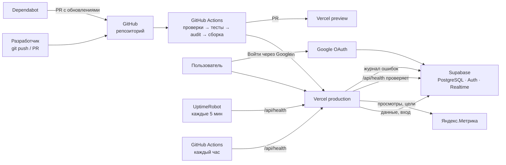

# Интеграции, CI/CD и эксплуатация «Семейного бюджета»

ДЗ6 «Настройка CI/CD и интеграция сервисов».

| | |
|---|---|
| **Приложение** | https://family-budget-sable-nu.vercel.app |
| **Проверка здоровья** | https://family-budget-sable-nu.vercel.app/api/health |
| **Репозиторий** | https://github.com/Akelov/family-budget |
| **Backend** | Supabase (документация ДЗ5 — [backend_documentation.md](../hw5/backend_documentation.md)) |

| Шаг | Подробно |
|-----|----------|
| 1. CI/CD | [01_cicd.md](01_cicd.md) |
| 2. Аудит безопасности | **[02_security_audit.md](02_security_audit.md) — отчёт по безопасности** |
| 3. OAuth2 (Google) | [03_oauth.md](03_oauth.md) |
| 4. Аналитика (Яндекс.Метрика) | [04_analytics.md](04_analytics.md) |
| 5. Платежи | [05_payments.md](05_payments.md) — не требуются |
| 6. Мониторинг | [06_monitoring.md](06_monitoring.md) |
| 7. Логирование | [07_logging.md](07_logging.md) |
| 8. Тестирование и оптимизация | [08_testing_optimization.md](08_testing_optimization.md) |

---

## 1. Архитектура после ДЗ6



---

## 2. Настройки CI/CD

**Платформа:** GitHub Actions. **Хостинг:** Vercel (Hobby). Файл: [.github/workflows/ci.yml](../../.github/workflows/ci.yml).

| Этап | Команда | Остановит деплой, если |
|------|---------|------------------------|
| Установка | `npm ci` | lock-файл не совпадает с `package.json` |
| Форматирование | `npm run format:check` (Prettier) | код не по правилам оформления |
| Линтинг | `npm run lint` (ESLint, typescript-eslint strict) | ошибки, `any` |
| Типы | `npm run typecheck` (TypeScript strict) | ошибки типов |
| Тесты | `npm test` (Vitest, 163 теста) | хоть один тест упал |
| Аудит | `npm audit --audit-level=high` | уязвимость high/critical |
| Сборка | `npm run build` | проект не собирается |
| Деплой | `vercel pull` → `vercel build --prod` → `vercel deploy --prebuilt --prod` | — |
| Smoke test | `/`, `/reports`, `/login` → 200; `/api/health` → `"status":"ok"` | сайт или база не отвечают после публикации |

- **push в `main`** → production; **Pull Request** → preview-адрес и комментарий со ссылкой в PR;
- деплой — **только из пайплайна** и только после всех проверок (`git.deploymentEnabled: false` в `vercel.json`);
- новый запуск для той же ветки отменяет предыдущий (`concurrency`);
- Dependabot ([dependabot.yml](../../.github/dependabot.yml)) — еженедельные PR с обновлениями npm и GitHub Actions;
- почасовой мониторинг — [health.yml](../../.github/workflows/health.yml).

### Переменные и секреты

| Где | Имя | Назначение | Секрет |
|-----|-----|-----------|--------|
| GitHub → Secrets | `VERCEL_TOKEN` | публикация на Vercel | **да** |
| GitHub → Variables | `VITE_SUPABASE_URL`, `VITE_SUPABASE_ANON_KEY` | адрес и публичный ключ Supabase | нет |
| GitHub → Variables | `VITE_YANDEX_METRIKA_ID` | номер счётчика Метрики (только production) | нет |
| пайплайн | `VITE_APP_VERSION` = `github.sha` | версия сборки в журнале ошибок | нет |
| Supabase → Auth → Google | Client ID, **Client Secret** | вход через Google | **секрет только в Supabase** |

В коде и репозитории секретов нет; GitHub Secret Protection и Push protection включены.

---

## 3. Интеграция сервисов — инструкции

### 3.1. Vercel

1. Зарегистрироваться на vercel.com (любым способом), тариф Hobby.
2. Account Settings → Tokens → **Create Token** → GitHub Secrets → `VERCEL_TOKEN`.
3. Push в `main` — пайплайн сам создаст проект `family-budget` и опубликует сайт.
4. Supabase → Authentication → URL Configuration: Site URL и Redirect URLs = адрес Vercel.

### 3.2. Google OAuth2

1. Google Cloud Console → проект → **Google Auth Platform**: экран согласия (External), тестовые пользователи.
2. **Clients → Create client → Web application**:
   origins — адрес сайта; redirect URI — `https://<проект>.supabase.co/auth/v1/callback`.
3. Supabase → Authentication → Sign In / Providers → **Google**: включить, Client ID + Client Secret → Save.
4. Код уже готов: `signInWithGoogle` в `features/auth/api/authApi.ts`, кнопка `GoogleSignIn`.

### 3.3. Яндекс.Метрика

1. metrika.yandex.ru → **Добавить счётчик**: адрес сайта, Вебвизор **выключен**.
2. Номер счётчика → GitHub Variables → `VITE_YANDEX_METRIKA_ID` → перезапустить пайплайн.
3. Цели → **JavaScript-событие**: `sign_up`, `transaction_created`, `budget_created`, `invite_accepted`, `login_google`.

### 3.4. UptimeRobot

1. uptimerobot.com → **New monitor** → тип **Keyword**.
2. URL `…/api/health`, ключевое слово `"status":"ok"`, инцидент — **если слова нет**, интервал 5 минут, оповещение — email.

### 3.5. Supabase (миграции ДЗ6)

SQL Editor → выполнить по порядку (после миграций ДЗ5):

| Файл | Что делает |
|------|-----------|
| `20261017160000_security_hardening.sql` | закрывает функции от гостя, закрепляет `search_path` (Security Advisor) |
| `20261018100000_logging.sql` | уровень `info` и версия сборки в журнале ошибок |

---

## 4. Отчёт по аудиту безопасности (кратко)

Полный отчёт — **[02_security_audit.md](02_security_audit.md)**.

| Находка | Уровень | Статус |
|---------|---------|--------|
| Vitest 3 / tinypool — выполнение кода (2 критических CVE) | критический | ✅ Vitest 4.1.11 |
| Нет CSP и других защитных заголовков | средний | ✅ `vercel.json` |
| Функции миграций 3–4 доступны гостю (Security Advisor) | средний | ✅ миграция 5, тест «до/после» |
| Пароль от 6 символов проходил на сервере | средний | ✅ Supabase Auth: 8 |
| Уязвимый Vitest в учебном примере ДЗ2 (Dependabot) | средний | ✅ обновлён |
| Обход проверки редиректа `/\evil` | низкий | ✅ `safeRedirectPath` + 9 тестов |
| `search_path` триггерных функций | низкий | ✅ миграция 5 |

OWASP Top 10: SQL-инъекции невозможны (нет динамического SQL, параметры отдельно), XSS закрыт
React + CSP, CSRF не применим (токен в заголовке, не cookie), доступ к данным — RLS + 76 проверок.

---

## 5. Мониторинг и логирование

| Что | Инструмент | Тревога |
|-----|------------|---------|
| Доступность сайта, входа, базы | UptimeRobot → `/api/health`, каждые 5 мин | email |
| То же, запасной канал | GitHub Actions, каждый час | письмо GitHub |
| После каждого деплоя | smoke test в пайплайне | красный запуск |
| Ошибки пользователей | `client_errors` (JSON, `info`/`warning`/`error`, версия) | SQL-запросы + промпты AI |
| Функция `/api/health` | Vercel Logs (JSON) | — |
| API, база, вход | Supabase Logs, Security Advisor | — |

---

## 6. Примеры конфигураций

**vercel.json** (фрагмент):

```json
{
  "framework": "vite",
  "git": { "deploymentEnabled": false },
  "rewrites": [{ "source": "/((?!assets/|api/).*)", "destination": "/index.html" }],
  "headers": [{ "source": "/(.*)", "headers": [
    { "key": "Content-Security-Policy", "value": "default-src 'self'; script-src 'self' https://mc.yandex.ru …; connect-src 'self' https://<проект>.supabase.co wss://<проект>.supabase.co https://mc.yandex.ru …; frame-ancestors 'none'; object-src 'none'" },
    { "key": "X-Frame-Options", "value": "DENY" },
    { "key": "Strict-Transport-Security", "value": "max-age=63072000; includeSubDomains; preload" }
  ]}]
}
```

**Деплой в ci.yml** (фрагмент):

```yaml
deploy-production:
  if: github.ref == 'refs/heads/main'
  needs: quality            # только после всех проверок
  steps:
    - run: npx vercel@61.1.0 build --prod --token="$VERCEL_TOKEN"
    - run: npx vercel@61.1.0 deploy --prebuilt --prod --token="$VERCEL_TOKEN" --env APP_VERSION="$GITHUB_SHA"
    - run: curl -s "$SITE/api/health" | grep -q '"status":"ok"'   # smoke test
```

**Ответ health check:**

```json
{ "status": "ok", "time": "2026-10-17T20:38:57Z", "version": "0a5aa8e",
  "checks": { "auth": { "ok": true, "latencyMs": 703 }, "database": { "ok": true, "latencyMs": 1120 } } }
```

**Запись журнала:**

```json
{ "level": "warning", "time": "2026-10-18T10:15:02Z", "version": "0a5aa8e",
  "screen": "reports", "code": "load_retry", "message": "Повтор 1: network" }
```

---

## 7. Процесс разработки с AI

Работа шла в паре: **владелец продукта** выполнял действия в панелях сервисов (Vercel, Google
Cloud, Supabase, Метрика, UptimeRobot, GitHub) и проверял сайт, **AI-агент** писал код,
конфигурации, тесты и документацию, анализировал логи и отчёты. Секреты (токен Vercel,
Client Secret Google) агенту не передавались — их владелец вводил сам.

| Шаг | Как помог AI |
|-----|--------------|
| CI/CD | сгенерировал пайплайн; когда вход в Vercel через GitHub не сработал, перестроил деплой на один токен (проект создаётся пайплайном) |
| Безопасность | `npm audit` + разбор OWASP; нашёл обход редиректа; по скриншоту Security Advisor воспроизвёл проблему прав тестом и исправил миграцией; по алерту Dependabot нашёл уязвимость в учебном примере |
| OAuth2 | код входа и обработки ошибок; по ответу `provider is not enabled` проверил настройки Supabase через API |
| Аналитика | список событий по воронке без личных данных; по `ERR_BLOCKED_BY_CLIENT` определил блокировщик |
| Мониторинг | health check без секретного ключа (отказ `42501` как признак живой базы) |
| Логирование | уровни и формат; по настоящему журналу нашёл ложную тревогу «Script error.» |
| Оптимизация | разбор состава сборки и Lighthouse; применил 4 рекомендации, 2 отклонил с обоснованием |

Памятка «10 частых проблем бэкенда» (ДЗ5) — [debug_playbook.md](../hw5/debug_playbook.md);
промпты анализа логов — [07_logging.md](07_logging.md#промпты-для-анализа-логов-с-помощью-ai).
